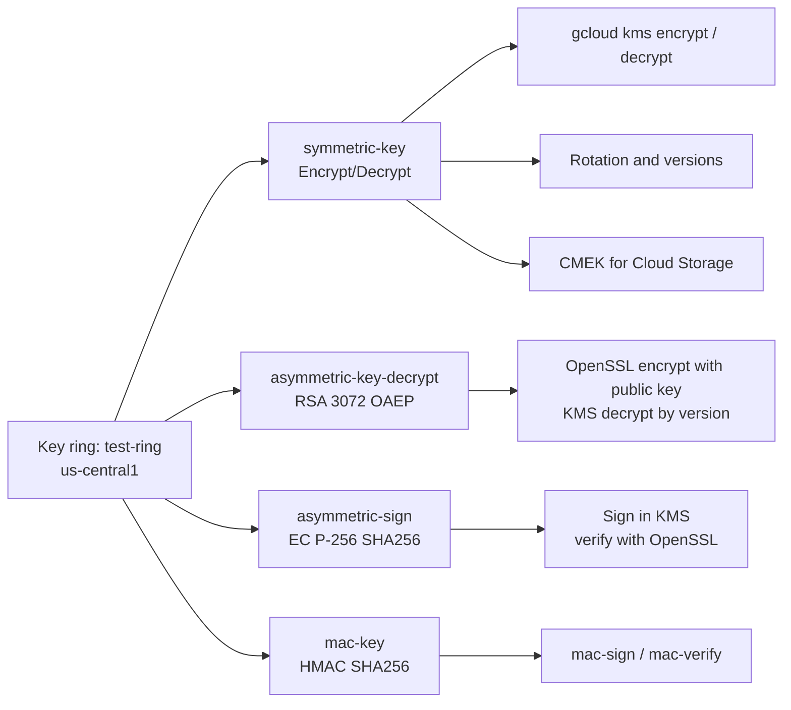

# GCP Cloud KMS Encryption Lab

Hands-on lab covering the four things you can do with Google Cloud KMS keys: **symmetric encryption**, **asymmetric encryption**, **digital signatures** and **MAC signatures**. It also shows key rotation, key versions, CMEK on Cloud Storage and what happens when a key is disabled.

   Companion article on Medium: [Cloud KMS on GCP, Hands-On: Encrypt, Rotate, Sign and Verify With Your Own Keys](https://medium.com/@YOUR_HANDLE/YOUR-ARTICLE-SLUG)
## What you will build



## Labs

| # | Lab | Key | Main commands | What it proves |
|---|---|---|---|---|
| 1 | Symmetric encryption | `symmetric-key` | `gcloud kms encrypt`, `decrypt` | One key encrypts and decrypts, and KMS picks the version from the ciphertext |
| 1b | Key rotation | `symmetric-key` | Rotate key, make primary | Old data still decrypts after rotation |
| 1c | CMEK on Cloud Storage | `symmetric-key` | Bucket with Cloud KMS key | Key and bucket must share a location. Service agent needs a role |
| 1d | Disable the key | `symmetric-key` | Disable versions | Data becomes unreadable at once, and is recoverable on re-enable |
| 2 | Asymmetric encryption | `asymmetric-key-decrypt` | `openssl pkeyutl`, `gcloud kms asymmetric-decrypt` | Public key encrypts, private key (in KMS) decrypts, and you must name the version |
| 3 | Digital signatures | `asymmetric-sign` | `gcloud kms asymmetric-sign`, `openssl dgst -verify` | Anyone with the public key can verify, and tampering is detected |
| 4 | MAC signatures | `mac-key` | `gcloud kms mac-sign`, `mac-verify` | Symmetric integrity check, so there is no public key |

## Repository layout

```
gcp-cloud-kms-encryption/
├── README.md
├── docs/
│   ├── cloud-kms-guide.md          # Full step-by-step SOP with screenshots
│   ├── medium-article.md           # Article draft (image links use raw GitHub URLs)
│   └── snapshots/
│       ├── 01-kms-theory/
│       ├── 02-symmetric-key-creation/
│       ├── 03-symmetric-encrypt-decrypt/
│       ├── 04-key-rotation/
│       ├── 05-cmek-cloud-storage/
│       ├── 06-key-disable-impact/
│       ├── 07-asymmetric-key-creation/
│       ├── 08-asymmetric-encrypt-decrypt/
│       ├── 09-digital-signatures/
│       └── 10-mac-signatures/
└── scripts/
    ├── 00-env.sh                    # location, key ring, work folder
    ├── 01-symmetric.sh
    ├── 02-asymmetric-encrypt.sh
    ├── 03-sign-verify.sh
    └── 04-mac.sh
```

## Prerequisites

- A GCP project with billing enabled
- Cloud KMS API enabled: `gcloud services enable cloudkms.googleapis.com`
- Cloud Shell (or a machine with `gcloud` and `openssl`)
- Roles: `roles/cloudkms.admin` and `roles/cloudkms.cryptoKeyEncrypterDecrypter` (Owner on a demo project covers both)

## Quick start

The keys were created in the console (see the guide for each screen). Once `test-ring` and the four keys exist:

```bash
git clone https://github.com/bikram-singh/gcp-cloud-kms-encryption.git
cd gcp-cloud-kms-encryption
gcloud config set project YOUR_PROJECT_ID

./scripts/01-symmetric.sh
./scripts/02-asymmetric-encrypt.sh        # VERSION=2 ./scripts/... shows the wrong-version failure
./scripts/03-sign-verify.sh
./scripts/04-mac.sh
```

The guide's [appendix](docs/cloud-kms-guide.md#10-appendix-cli-equivalents-of-the-console-steps) lists `gcloud` commands that create the same keys.

## Key takeaways

1. **Choose the purpose first.** It is fixed at creation and decides which operations the key supports.
2. **Symmetric keys have a primary version. Asymmetric keys do not.** For asymmetric operations you always name the version.
3. **Rotation does not re-encrypt old data.** It only changes the version used for new operations, and old versions keep decrypting.
4. **CMEK needs two things right:** same location as the resource, and the service agent holding `cloudkms.cryptoKeyEncrypterDecrypter` on the key.
5. **Disabling a key is a kill switch.** Access to the data stops immediately and returns when you re-enable the version.
6. **Signatures use asymmetric keys. MACs use a shared symmetric key**, so a MAC key has no public key to download.
7. **Key rings and keys cannot be deleted.** Only versions can be destroyed, after the scheduled destruction delay.

## Cleanup

```bash
gsutil rm -r gs://cloud-kms-demo-bucket          # if you created the CMEK bucket
```

Then destroy the demo key versions in *Security → Key Management*. Active key versions are billed.

## Notes

- Screenshots show the demo project, so replace the project ID with your own when you reproduce the lab. Do not commit real keys, ciphertext or secrets.
- Theory slides in `01-kms-theory` come from the source video series linked at the end of the guide.

## Author

**Bikram Singh** · GCP Infrastructure and DevOps Lead · [GitHub](https://github.com/bikram-singh) · Medium

## License

MIT
