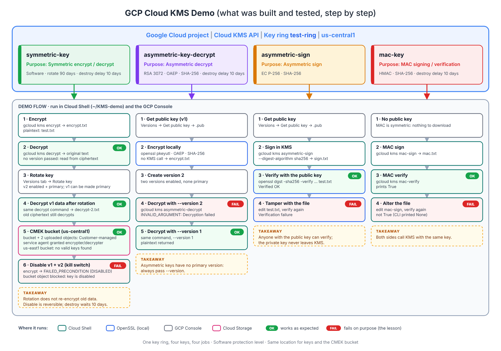

<div align="center">

# 🔑 gcp-cloud-kms-encryption

### Cloud KMS Hands-On · Symmetric Encryption · Key Rotation · CMEK · Asymmetric Encryption · Digital Signatures · MAC

[](https://cloud.google.com/kms/docs)
[](https://cloud.google.com/kms/docs/cmek)
[](#-step-3--encrypt-and-decrypt)
[](#-step-8--asymmetric-encrypt-and-decrypt)
[](#-step-9--digital-signatures)
[](#-step-10--mac-signatures)
[](#-snapshots)

---

*A real, hands-on tour of **Google Cloud KMS**: create a key ring and keys, **encrypt and decrypt** with `gcloud`, **rotate** keys and watch key versions, protect a Cloud Storage bucket with a **customer-managed key (CMEK)**, see what happens when a key is **disabled**, then use **asymmetric keys** for encryption and **digital signatures**, and a **MAC key** for integrity checks. Every step is backed by real GCP Console and Cloud Shell screenshots.*

📝 **Companion article on Medium:** *GCP Cloud KMS Explained With Real Demos: Encryption, Key Rotation, CMEK, Digital Signatures and MAC* (add the link here once published)



</div>

---

## 📋 Table of Contents

- [Overview](#-overview)
- [Architecture](#-architecture)
- [Theory: The Concepts You Need](#-theory-the-concepts-you-need)
- [Design and Naming Plan](#-design-and-naming-plan)
- [What Was Built](#-what-was-built)
- [Prerequisites](#-prerequisites)
- [Repository Structure](#-repository-structure)
- [Step 1: Enable the API and Create the Key Ring](#-step-1--enable-the-api-and-create-the-key-ring)
- [Step 2: Create the Symmetric Key](#-step-2--create-the-symmetric-key)
- [Step 3: Encrypt and Decrypt](#-step-3--encrypt-and-decrypt)
- [Step 4: Rotate the Key](#-step-4--rotate-the-key)
- [Step 5: CMEK on Cloud Storage](#-step-5--cmek-on-cloud-storage)
- [Step 6: Disable the Key](#-step-6--disable-the-key)
- [Step 7: Asymmetric Key and Public Key](#-step-7--asymmetric-key-and-public-key)
- [Step 8: Asymmetric Encrypt and Decrypt](#-step-8--asymmetric-encrypt-and-decrypt)
- [Step 9: Digital Signatures](#-step-9--digital-signatures)
- [Step 10: MAC Signatures](#-step-10--mac-signatures)
- [Which Key Purpose Should You Use?](#-which-key-purpose-should-you-use)
- [Gotchas Reference Table](#-gotchas-reference-table)
- [Troubleshooting](#-troubleshooting)
- [Security Checklist](#-security-checklist)
- [Cost and Cleanup](#-cost-and-cleanup)
- [Snapshots](#-snapshots)
- [Resources](#-resources)

---

## 🌐 Overview

Google encrypts data at rest by default, but many teams need to **control the keys themselves**: who can use them, when they rotate, and the ability to switch access off. **Cloud KMS** is the service for that. It is the engine behind CMEK for Cloud Storage, BigQuery, Cloud SQL and more, and you can also call it directly to encrypt, sign and verify your own data.

This lab walks through **all four things you can do with a KMS key**, in the order you would meet them in real work.

### 🔑 Key Facts

| Property | Value |
|---|---|
| ☁️ **Cloud** | Google Cloud, location `us-central1` |
| 🗝️ **Key ring** | `test-ring` |
| 🔐 **Protection level** | Software (HSM and External are shown in the console) |
| 🧬 **Keys created** | 4: `symmetric-key`, `asymmetric-key-decrypt`, `asymmetric-sign`, `mac-key` |
| 🔄 **Rotation** | Symmetric key every **90 days**, plus a manual rotation in the demo |
| ⏳ **Scheduled destruction** | **10 days** on the symmetric, asymmetric decrypt and MAC keys (the default is 30) |
| 🪣 **CMEK target** | Cloud Storage bucket `cloud-kms-demo-bucket` |
| 🛠️ **Tooling** | GCP Console, Cloud Shell, `gcloud`, `gsutil`, `openssl` |
| 📸 **Evidence** | 50 real console and Cloud Shell screenshots, sorted by step in [`docs/snapshots/`](docs/snapshots) |

### ✨ What Makes This Different

| Capability | Description |
|---|---|
| 🔁 **All four key purposes in one lab** | Symmetric, asymmetric decrypt, asymmetric sign and MAC, each with a working command |
| 🧪 **Failures are shown, not hidden** | Wrong key version, disabled key, tampered file and altered MAC input all fail on camera |
| 🪣 **A real CMEK use case** | A bucket encrypted with your own key, including the location rule and the service-agent role |
| 🔄 **Rotation proven** | Data encrypted with version 1 still decrypts after version 2 becomes primary |
| 🧰 **Reusable scripts** | Four small shell scripts reproduce the CLI steps |

### ❓ Why Customer-Managed Keys?

| Benefit | How It Showed Up Here |
|---|---|
| **Control over who can use the key** | The Cloud Storage service agent needed an explicit `cryptoKeyEncrypterDecrypter` grant |
| **A kill switch** | Disabling the key versions made the bucket object unreadable at once |
| **Rotation on your terms** | A 90-day schedule plus an on-demand rotate in one click |
| **Auditability** | Key use can be logged with Cloud Audit Logs (enable Data Access logs for KMS) |

---

## 🏛️ Architecture

```
                         Project (Cloud KMS API enabled) · us-central1
  ┌──────────────────────────────────────────────────────────────────────────────┐
  │  Key ring: test-ring                                                         │
  │                                                                              │
  │   🔑 symmetric-key           Symmetric encrypt/decrypt · 90-day rotation     │
  │        ├── gcloud kms encrypt / decrypt  (Cloud Shell)                       │
  │        └── CMEK ──► Cloud Storage bucket: cloud-kms-demo-bucket              │
  │                                                                              │
  │   🔐 asymmetric-key-decrypt  RSA 3072 · OAEP · SHA-256                       │
  │        ├── public key ──► openssl encrypt (local, no KMS call)               │
  │        └── private key stays in KMS ──► gcloud kms asymmetric-decrypt        │
  │                                                                              │
  │   ✍️ asymmetric-sign         EC P-256 · SHA-256                              │
  │        ├── gcloud kms asymmetric-sign  (private key, in KMS)                 │
  │        └── public key ──► openssl dgst -verify  (anyone can verify)          │
  │                                                                              │
  │   🧾 mac-key                 HMAC · SHA-256  (symmetric, no public key)      │
  │        └── gcloud kms mac-sign / mac-verify                                  │
  └──────────────────────────────────────────────────────────────────────────────┘
```

| Key | Purpose | Algorithm | Rotation | Who needs what |
|---|---|---|---|---|
| 🟢 `symmetric-key` | Symmetric encrypt/decrypt | Google symmetric key | Automatic, 90 days | Callers need IAM on the key |
| 🟣 `asymmetric-key-decrypt` | Asymmetric decrypt | RSA 3072 · OAEP · SHA-256 | Manual only | Anyone can encrypt with the public key |
| 🟠 `asymmetric-sign` | Asymmetric sign | EC P-256 · SHA-256 | Manual only | Anyone can verify with the public key |
| 🔴 `mac-key` | MAC signing/verification | HMAC · SHA-256 | Manual only | Both sides call KMS with the same key |

### 🔄 Build Order

```
 Enable API ──► Key ring ──► Symmetric key ──► Encrypt / Decrypt ──► Rotate key
                                   │
                                   ▼
                    CMEK bucket (same location + service-agent role)
                                   │
                                   ▼
                       Disable key ──► data unreadable ──► re-enable
                                   │
                                   ▼
   Asymmetric decrypt key ──► public key ──► openssl encrypt ──► KMS decrypt (by version)
                                   │
                                   ▼
        Signing key ──► sign in KMS ──► verify with openssl ──► tamper ──► fails
                                   │
                                   ▼
                         MAC key ──► mac-sign ──► mac-verify ──► alter ──► fails ✅
```

---

## 🧠 Theory: The Concepts You Need

| Concept | What it is | Role in this lab |
|---|---|---|
| 🗝️ **Key ring** | A group of keys in one location. Cannot be deleted | `test-ring` in `us-central1` |
| 🔑 **Key** | A named object with a purpose and one or more versions | Four keys, one per purpose |
| 🔢 **Key version** | The actual key material. Enabled, disabled, scheduled for destruction or destroyed | Rotation creates version 2 |
| 🥇 **Primary version** | The version a **symmetric** key uses for new encryption | Switching it changes only *new* operations |
| 🎯 **Purpose** | Fixed at creation. Decides which operations a key supports | Symmetric, asymmetric decrypt, asymmetric sign, MAC |
| 🪣 **CMEK** | Customer-managed encryption keys used by Google Cloud services | Cloud Storage bucket encrypted with `symmetric-key` |
| 🤖 **Service agent** | The service identity that calls KMS for you | Needs `cloudkms.cryptoKeyEncrypterDecrypter` on the key |
| 🔄 **Rotation** | Creates a new version for new data. Does **not** re-encrypt old data | Old ciphertext still decrypts |
| 🧪 **Envelope encryption** | A data key encrypts data, and KMS wraps the data key | The standard pattern for large data |
| 🔀 **Symmetric vs asymmetric** | One shared key vs a public/private pair | Symmetric and MAC use one key. Encryption and signing here use pairs |

### 🧭 Key Purposes at a Glance

| Scenario | Purpose in the console | API purpose | Methods |
|---|---|---|---|
| Symmetric encryption | Symmetric encrypt/decrypt | `ENCRYPT_DECRYPT` | `encrypt`, `decrypt` |
| Raw symmetric encryption | Raw symmetric encrypt/decrypt | `RAW_ENCRYPT_DECRYPT` | `rawEncrypt`, `rawDecrypt` |
| Asymmetric encryption | Asymmetric decrypt | `ASYMMETRIC_DECRYPT` | `getPublicKey`, `asymmetricDecrypt` |
| Asymmetric signing | Asymmetric sign | `ASYMMETRIC_SIGN` | `getPublicKey`, `asymmetricSign` |
| MAC signing | MAC signing/verification | `MAC` | `macSign`, `macVerify` |

### 🛡️ Protection Levels

| Level | Where key material lives | Typical use |
|---|---|---|
| 💻 **Software** | Google software-based module | General CMEK, cost-sensitive (used in this lab) |
| 🔒 **HSM** | FIPS 140-2 Level 3 HSMs | Regulated workloads |
| 🌍 **External (EKM)** | Your external key manager | Keys held outside Google |

---

## 📐 Design and Naming Plan

| Item | Value |
|---|---|
| Project | your own GCP project (`PROJECT_ID`) |
| Location | `us-central1` |
| Key ring | `test-ring` |
| Symmetric key | `symmetric-key` (rotation 90 days, destruction delay 10 days) |
| Asymmetric decrypt key | `asymmetric-key-decrypt` (RSA 3072 · OAEP · SHA-256) |
| Signing key | `asymmetric-sign` (EC P-256 · SHA-256) |
| MAC key | `mac-key` (HMAC · SHA-256) |
| Test bucket | `cloud-kms-demo-bucket` (`us-central1`, Standard) |
| Work folders in Cloud Shell | `~/KMS-demo`, `~/KMS-demo/Asymmetric-sign`, `~/KMS-demo/MAC-sign` |

> ⚠️ **The key and the resource it protects must be in the same location.** A `us-central1` key cannot protect a `us-east1` bucket.
>
> 🔑 **Never commit real keys, ciphertext or secrets.** Use throwaway test files like the ones in this lab.

---

## 🏗️ What Was Built

| Capability | Result |
|---|---|
| Key ring and four keys | ✅ `test-ring` with `symmetric-key`, `asymmetric-key-decrypt`, `asymmetric-sign`, `mac-key` |
| Symmetric encrypt / decrypt | ✅ Round trip with `gcloud kms encrypt` and `decrypt` |
| Rotation | ✅ Version 2 primary, version 1 ciphertext still decrypts |
| CMEK | ✅ Bucket and objects show *Customer-managed* with the key version |
| Disable key | ✅ Encrypt fails with `FAILED_PRECONDITION`, object download blocked |
| Asymmetric encrypt / decrypt | ✅ OpenSSL encrypts, KMS decrypts. Wrong version fails with `Decryption failed` |
| Digital signature | ✅ `Verified OK`, then `Verification failure` after tampering |
| MAC | ✅ `True`, then a failed check after the file is altered |

---

## ✅ Prerequisites

- ☁️ A **GCP project** with billing enabled (a free-trial project works)
- 🔌 The **Cloud KMS API** enabled
- 👤 Roles: `roles/cloudkms.admin` to create keys and `roles/cloudkms.cryptoKeyEncrypterDecrypter` to use symmetric keys (Owner on a demo project covers both)
- 🖥️ **Cloud Shell**, or a machine with `gcloud`, `gsutil` and `openssl`
- 🪣 Permission to create a Cloud Storage bucket for the CMEK step

---

## 📁 Repository Structure

```
gcp-cloud-kms-encryption/
│
├── docs/
│   ├── cloud-kms-guide.md                   # Step-by-step SOP with commands and screenshots
│   ├── medium-article.md                    # Article draft (image links use raw GitHub URLs)
│   └── snapshots/                           # Real console and Cloud Shell screenshots
│       ├── 00-architecture/                 #   architecture diagram
│       ├── 01-symmetric-key-creation/       #  11 screenshots
│       ├── 02-symmetric-encrypt-decrypt/    #   2 screenshots
│       ├── 03-key-rotation/                 #   5 screenshots
│       ├── 04-cmek-cloud-storage/           #   6 screenshots
│       ├── 05-key-disable-impact/           #   3 screenshots
│       ├── 06-asymmetric-key-creation/      #   6 screenshots
│       ├── 07-asymmetric-encrypt-decrypt/   #   7 screenshots
│       ├── 08-digital-signatures/           #   5 screenshots
│       └── 09-mac-signatures/               #   5 screenshots
│
├── scripts/
│   ├── 00-env.sh                            # location, key ring, work folder
│   ├── 01-symmetric.sh                      # encrypt / decrypt round trip
│   ├── 02-asymmetric-encrypt.sh             # openssl encrypt, KMS decrypt by version
│   ├── 03-sign-verify.sh                    # sign in KMS, verify with openssl
│   └── 04-mac.sh                            # mac-sign / mac-verify
│
└── README.md                                # This file
```

---

## 🔹 Step 1 · Enable the API and Create the Key Ring

**Marketplace → Cloud Key Management Service (KMS) API → Enable**, or run `gcloud services enable cloudkms.googleapis.com`.

Then go to **Security → Key Management → Key rings → Create key ring**.

| Field | Value |
|---|---|
| Key ring name | `test-ring` |
| Location | `us-central1` |

> ⚠️ A key ring is tied to its location and **cannot be deleted**. Choose the name and location deliberately.

<table>
<tr>
<td width="50%">

**Enable the Cloud KMS API**


</td>
<td width="50%">

**Create key ring**


</td>
</tr>
</table>

---

## 🔹 Step 2 · Create the Symmetric Key

Inside `test-ring` choose **Create key**.

| Field | Value |
|---|---|
| Key name | `symmetric-key` |
| Protection level | **Software** (HSM and External are the other choices) |
| Key material | **Generated key** (the alternative is *Imported key*) |
| Purpose | **Symmetric encrypt/decrypt** |
| Algorithm | Google symmetric key |
| Rotation period | **90 days** (options: 30, 90, 180, 365, never, custom) |
| Scheduled destruction | **10 days** (default 30) |

> 💡 The scheduled destruction delay is your safety net. A destroyed version waits that many days in *scheduled for destruction*, and you can still restore it.

<table>
<tr>
<td width="50%">

**Key name and protection level**


</td>
<td width="50%">

**Choosing External asks for an EKM connection**


</td>
</tr>
<tr>
<td width="50%">

**Key material: generated or imported**


</td>
<td width="50%">

**Purpose dropdown**


</td>
</tr>
<tr>
<td width="50%">

**Symmetric purpose and algorithm**


</td>
<td width="50%">

**Rotation period options**


</td>
</tr>
<tr>
<td width="50%">

**Rotation summary: every 90 days**


</td>
<td width="50%">

**Destruction delay: 10 days**


</td>
</tr>
</table>

✅ **Result:** `symmetric-key` shows as **Available**, protection level *Software*, purpose *Symmetric encrypt/decrypt*.


---

## 🔹 Step 3 · Encrypt and Decrypt

In **Cloud Shell**, create a test file and encrypt it.

```bash
mkdir -p ~/KMS-demo && cd ~/KMS-demo
echo "Welcome to Cloud KMS Demo" > test.txt

# Encrypt
gcloud kms encrypt \
  --key symmetric-key \
  --keyring test-ring \
  --location us-central1 \
  --plaintext-file test.txt \
  --ciphertext-file encrypt.txt

# Decrypt
gcloud kms decrypt \
  --key symmetric-key \
  --keyring test-ring \
  --location us-central1 \
  --ciphertext-file encrypt.txt \
  --plaintext-file decrypt.txt

cat decrypt.txt        # Welcome to Cloud KMS Demo
```

> 💡 You never pass a key version. KMS reads it from the ciphertext, and uses the primary version for new encryption.

<table>
<tr>
<td width="50%">

**Encrypt: `encrypt.txt` is unreadable**


</td>
<td width="50%">

**Decrypt: original text returned**


</td>
</tr>
</table>

---

## 🔹 Step 4 · Rotate the Key

Rotation creates a **new key version** and makes it primary, so *new* data uses fresh key material. Open the key, go to **Versions**, and click **Rotate key**.

> ⚠️ Older versions can still decrypt, and data encrypted with them is **not** re-encrypted unless you do it yourself.

<table>
<tr>
<td width="50%">

**Versions tab: version 1 is primary**


</td>
<td width="50%">

**Rotate key dialog**


</td>
</tr>
<tr>
<td width="50%">

**Version 2 is Enabled and primary**


</td>
<td width="50%">

**Make a different version primary (optional)**


</td>
</tr>
</table>

### 🧪 Prove old data still decrypts

`encrypt.txt` was created with **version 1**. Decrypt it again after rotation:

```bash
gcloud kms decrypt \
  --key symmetric-key \
  --keyring test-ring \
  --location us-central1 \
  --ciphertext-file encrypt.txt \
  --plaintext-file decrypt-2.txt

cat decrypt-2.txt      # Welcome to Cloud KMS Demo
```


---

## 🔹 Step 5 · CMEK on Cloud Storage

**Cloud Storage → Create bucket.** Name `cloud-kms-demo-bucket`, region `us-central1`. Under **Data encryption**, select **Cloud KMS key**, then pick `symmetric-key`.

### ⚠️ Gotcha 1: location

The key is in `us-central1`. A bucket in `us-east1` shows **"No valid keys found"**, because the filter requires the same location.


### ⚠️ Gotcha 2: service agent

The console warns that the Cloud Storage service agent does not have `cloudkms.cryptoKeyEncrypterDecrypter` on the key. Click **Grant**.


### ✅ Verify

<table>
<tr>
<td width="50%">

**Bucket: Encryption type = Customer-managed**


</td>
<td width="50%">

**Objects: Encryption column = Customer-managed**


</td>
</tr>
<tr>
<td width="50%">

**Object details show the exact key version**


</td>
<td width="50%">

**Cloud Shell listing works as normal**


</td>
</tr>
</table>

```bash
gsutil ls gs://cloud-kms-demo-bucket/
```

---

## 🔹 Step 6 · Disable the Key

This is the **kill switch** that makes CMEK valuable. On the **Versions** tab, disable both versions.

| Where | What you see |
|---|---|
| 🔑 Key page | Status **Not available**: *"To operate on data with this key, enable primary version or select a new primary version."* |
| 💻 Cloud Shell | `gcloud kms encrypt` fails with **`FAILED_PRECONDITION`**: the key version is `DISABLED` |
| 🪣 Bucket object | **"Cloud KMS key is disabled, destroyed, or scheduled to be destroyed."** |

<table>
<tr>
<td width="33%">

**Key not available**


</td>
<td width="33%">

**Encrypt fails**


</td>
<td width="33%">

**Object download blocked**


</td>
</tr>
</table>

> ✅ **Disable is reversible.** Re-enable the versions and access returns. **Destroy is not**, once the scheduled destruction delay passes.

---

## 🔹 Step 7 · Asymmetric Key and Public Key

With an asymmetric key there is a **key pair**. The **public key** is shared and encrypts. The **private key** never leaves KMS and decrypts.

**Create key** in `test-ring`:

| Field | Value |
|---|---|
| Key name | `asymmetric-key-decrypt` |
| Protection level | Software |
| Key material | Generated |
| Purpose | **Asymmetric decrypt** |
| Algorithm | **3072 bit RSA - OAEP Padding - SHA256 Digest** |
| Rotation | Not available (manual only) |
| Scheduled destruction | 10 days |

<table>
<tr>
<td width="50%">

**Key name**


</td>
<td width="50%">

**Purpose and algorithm**


</td>
</tr>
<tr>
<td width="50%">

**Destruction delay and review**


</td>
<td width="50%">

**Key overview**


</td>
</tr>
</table>

### 📥 Download the public key

**Versions → ⋮ → Get public key → Download**, or:

```bash
gcloud kms keys versions get-public-key 1 \
  --key asymmetric-key-decrypt \
  --keyring test-ring \
  --location us-central1 \
  --output-file test-ring-asymmetric-key-decrypt-1.pub
```

<table>
<tr>
<td width="50%">

**Get public key**


</td>
<td width="50%">

**Public key dialog**


</td>
</tr>
</table>

---

## 🔹 Step 8 · Asymmetric Encrypt and Decrypt

### 🔒 Encrypt locally with OpenSSL (no KMS call)

```bash
echo "Welcome to Cloud KMS Asymmetric key demo" > test.txt

openssl pkeyutl -in test.txt \
  -encrypt \
  -pubin \
  -inkey test-ring-asymmetric-key-decrypt-1.pub \
  -pkeyopt rsa_padding_mode:oaep \
  -pkeyopt rsa_oaep_md:sha256 \
  -pkeyopt rsa_mgf1_md:sha256 \
  > encrypt.txt
```

> 💡 The padding and digest must match the key algorithm: **OAEP with SHA-256**.

<table>
<tr>
<td width="50%">

**Public key and test file in Cloud Shell**


</td>
<td width="50%">

**OpenSSL encrypt**


</td>
</tr>
</table>

### 🔓 Decrypt in KMS: you must name the version

Asymmetric keys have **no primary version**, so `--version` is required.

```bash
gcloud kms asymmetric-decrypt \
  --version 1 \
  --key asymmetric-key-decrypt \
  --keyring test-ring \
  --location us-central1 \
  --ciphertext-file encrypt.txt \
  --plaintext-file decrypt.txt
```

### 🧪 Prove the version matters

Create a second version (**Create version → confirm**). Both versions are enabled, and none is labelled primary.

<table>
<tr>
<td width="33%">

**Create version**


</td>
<td width="33%">

**Confirm**


</td>
<td width="33%">

**Two versions, no primary**


</td>
</tr>
</table>

`encrypt.txt` was encrypted with the **version 1** public key, so decrypting with `--version 2` fails, and `--version 1` works.

<table>
<tr>
<td width="50%">

**❌ `--version 2`: `INVALID_ARGUMENT: Decryption failed.`**


</td>
<td width="50%">

**✅ `--version 1`: plaintext returned**


</td>
</tr>
</table>

> 🎯 **Takeaway:** store the key version alongside the ciphertext.

---

## 🔹 Step 9 · Digital Signatures

A digital signature proves **who** signed and that the data was **not changed**. The signer uses the private key in KMS. **Anyone** with the public key can verify.

**Create key:**

| Field | Value |
|---|---|
| Key name | `asymmetric-sign` |
| Protection level | Software |
| Purpose | **Asymmetric sign** |
| Algorithm | **Elliptic Curve P-256 - SHA256 Digest** |

<table>
<tr>
<td width="33%">

**Key name**


</td>
<td width="33%">

**Purpose and algorithm**


</td>
<td width="33%">

**Get public key**


</td>
</tr>
</table>

### ✍️ Sign in KMS, verify with OpenSSL

```bash
mkdir -p ~/KMS-demo/Asymmetric-sign && cd ~/KMS-demo/Asymmetric-sign
echo "This is Asymmetric-sign demo" > test.txt

# Download the public key
gcloud kms keys versions get-public-key 1 \
  --key asymmetric-sign --keyring test-ring --location us-central1 \
  --output-file test-ring-asymmetric-sign-1.pub

# Sign
gcloud kms asymmetric-sign \
  --version 1 \
  --key asymmetric-sign \
  --keyring test-ring \
  --location us-central1 \
  --digest-algorithm sha256 \
  --input-file test.txt \
  --signature-file sign.txt

# Verify
openssl dgst -sha256 \
  -verify test-ring-asymmetric-sign-1.pub \
  -signature sign.txt \
  test.txt
```

<table>
<tr>
<td width="50%">

**✅ `Verified OK`**


</td>
<td width="50%">

**❌ Tampered file: `Verification failure`**


</td>
</tr>
</table>

> 💡 **Real-world use:** send the file together with `sign.txt`. The recipient verifies with your public key and knows the file is yours and unmodified. The same pattern secures code, container images and tokens.

---

## 🔹 Step 10 · MAC Signatures

A **MAC** also proves integrity and authenticity, but it is **symmetric**: the same secret key creates and verifies the tag. That is why a MAC key has **no public key** to download.

**Create key:**

| Field | Value |
|---|---|
| Key name | `mac-key` |
| Protection level | Software |
| Purpose | **MAC signing/verification** |
| Algorithm | **HMAC - SHA256 Digest** |
| Rotation | Not available |
| Scheduled destruction | 10 days |

<table>
<tr>
<td width="50%">

**Create MAC key**


</td>
<td width="50%">

**Version menu: no "Get public key"**


</td>
</tr>
</table>

### 🧾 Sign and verify

```bash
mkdir -p ~/KMS-demo/MAC-sign && cd ~/KMS-demo/MAC-sign
echo "This is the MAC signing demo" > mac-sign

# Sign
gcloud kms mac-sign \
  --version 1 \
  --key mac-key \
  --keyring test-ring \
  --location us-central1 \
  --input-file mac-sign \
  --signature-file mac.txt

# Verify
gcloud kms mac-verify \
  --version 1 \
  --key mac-key \
  --keyring test-ring \
  --location us-central1 \
  --input-file mac-sign \
  --signature-file mac.txt
```

<table>
<tr>
<td width="33%">

**Sign**


</td>
<td width="33%">

**✅ Verify prints `True`**


</td>
<td width="33%">

**❌ Altered file: not `True`**


</td>
</tr>
</table>

### 🔍 Two ways to prove a file was not altered

1. 🧾 **MAC verification:** share the tag and verify it with the shared MAC key.
2. 🔁 **Regenerate and `diff`:** re-create the file from the same source and run `diff file1 file1-regenerated`. This only works when you can reproduce the file.

---

## 🧭 Which Key Purpose Should You Use?

| Need | Purpose | Who holds what |
|---|---|---|
| 🔒 Encrypt your own data, or CMEK for GCP services | Symmetric encrypt/decrypt | Key stays in KMS. Callers need IAM on the key |
| 📬 Let outsiders send you encrypted data | Asymmetric decrypt | Anyone holds the public key. Private key stays in KMS |
| ✍️ Prove who published something and that it is unchanged | Asymmetric sign | Private key signs in KMS. Anyone verifies with the public key |
| 🧾 Integrity check between two trusted parties | MAC | Both sides call KMS with the same key. No public key exists |

---

## 🛡️ Gotchas Reference Table

| Area | Gotcha |
|---|---|
| 🎯 Purpose | Fixed at creation. You cannot change it later |
| 🗝️ Key rings and keys | Cannot be deleted. Only key **versions** can be destroyed |
| 📍 Location | The key and the resource it protects must share a location |
| 🤖 Service agent | Grant `cloudkms.cryptoKeyEncrypterDecrypter` before creating CMEK resources. A missing grant is the most common CMEK failure |
| 🔄 Rotation | Does not re-encrypt old data. It only changes the version for new operations |
| 🥇 Primary version | Symmetric keys have one. **Asymmetric keys have none**, so you always pass `--version` |
| 🔢 Asymmetric ciphertext | Bound to the key version whose public key was used. Track the version |
| 🔌 Disable vs destroy | Disable is reversible. Destroy is not once the scheduled delay passes |
| 🔓 Public key | Only asymmetric keys have one. MAC keys do not |
| 🔐 OpenSSL options | For RSA OAEP use `rsa_padding_mode:oaep`, `rsa_oaep_md:sha256` and `rsa_mgf1_md:sha256` to match the key |

---

## 🔧 Troubleshooting

| Symptom | Likely cause |
|---|---|
| Key picker says **"No valid keys found"** | The key is in a different location from the bucket, or the purpose is not symmetric encrypt/decrypt |
| Console warns the service agent lacks a role | Grant `cloudkms.cryptoKeyEncrypterDecrypter` on the key to the service agent shown in the message |
| `FAILED_PRECONDITION … state is: DISABLED` | The key version is disabled. Enable it, or set another enabled primary version |
| Bucket object returns **"Cloud KMS key is disabled, destroyed, or scheduled to be destroyed"** | The key version that encrypted the object is not enabled |
| `INVALID_ARGUMENT: Decryption failed` on `asymmetric-decrypt` | Wrong `--version`, or OpenSSL used different padding or digest options than the key expects |
| `PERMISSION_DENIED` | Your user lacks `cloudkms.cryptoKeyEncrypterDecrypter` (or the signer/verifier role) on the key |
| `Verification failure` from `openssl dgst` | The file changed after signing, or the wrong public key or version was used |
| `mac-verify` does not print `True` | The input file differs from the one signed, or the wrong key version was used |

---

## 🔒 Security Checklist

- 🧑‍⚖️ **Separate duties:** `cloudkms.admin` manages keys and cannot use them. `cloudkms.cryptoKeyEncrypterDecrypter` uses keys and cannot manage them.
- 🏗️ **Use a dedicated KMS project** for key rings, apart from workloads.
- 📜 **Turn on Data Access audit logs** for Cloud KMS. Admin Activity logs are always on.
- 🚨 **Alert on key disable and destroy events.** Disabling a key makes data unreadable immediately.
- ⏳ **Keep a destruction delay** long enough to recover from mistakes.
- 🧱 **Prevent accidental deletion** of keys in Terraform with `prevent_destroy`.
- 🗑️ **Never commit** keys, ciphertext or secrets to Git.

---

## 💰 Cost and Cleanup

⚠️ **Active key versions are billed**, and so are key operations and the bucket you create. See the [Cloud KMS pricing page](https://cloud.google.com/kms/pricing) before leaving the demo running.

**Cleanup**

1. 🪣 Delete the demo bucket and its objects:
   ```bash
   gsutil rm -r gs://cloud-kms-demo-bucket
   ```
2. 🔑 Destroy the key versions you no longer need (**Versions → select → Destroy**, or `gcloud kms keys versions destroy`).
3. 🧹 Remove local files: `rm -rf ~/KMS-demo`.

> ℹ️ Key rings and keys remain in the project after cleanup. Only their versions are destroyed.

---

## 📸 Snapshots

Real screenshots taken directly from the Google Cloud Console and Cloud Shell while building this demo, all under [`docs/snapshots/`](docs/snapshots), grouped by step.

| Folder | Step | Files |
|---|---|---|
| `00-architecture` | Architecture diagram | 1 |
| `01-symmetric-key-creation` | API, key ring, symmetric key | 11 |
| `02-symmetric-encrypt-decrypt` | Encrypt and decrypt in Cloud Shell | 2 |
| `03-key-rotation` | Rotation and key versions | 5 |
| `04-cmek-cloud-storage` | CMEK bucket | 6 |
| `05-key-disable-impact` | Disabled key | 3 |
| `06-asymmetric-key-creation` | Asymmetric key and public key | 6 |
| `07-asymmetric-encrypt-decrypt` | OpenSSL encrypt, KMS decrypt | 7 |
| `08-digital-signatures` | Sign and verify | 5 |
| `09-mac-signatures` | MAC sign and verify | 5 |

> 🔍 The screenshots show the demo project. Replace the project ID with your own when you reproduce the lab.

---

## 🔗 Resources

- [Cloud KMS documentation](https://cloud.google.com/kms/docs)
- [Customer-managed encryption keys (CMEK)](https://cloud.google.com/kms/docs/cmek)
- [Encrypt and decrypt data with an asymmetric key](https://cloud.google.com/kms/docs/encrypt-decrypt-rsa)
- [Cloud KMS pricing](https://cloud.google.com/kms/pricing)
- 📘 [Step-by-step guide in this repo](docs/cloud-kms-guide.md)

---

<div align="center">

**Maintained by Bikram Singh**

*Built and verified hands-on with Google Cloud KMS*

</div>
