# Cloud KMS Hands-On Guide (SOP)

Step-by-step procedure for the four Cloud KMS demos in this lab: symmetric encryption, asymmetric encryption, digital signatures and MAC signatures. Every step lists the console action, the command, the expected result and the matching screenshot.

> **Conventions**
> - Project: `PROJECT_ID` (replace with your own)
> - Location: `us-central1`
> - Key ring: `test-ring`
> - Commands run in **Cloud Shell**, in a working folder called `KMS-demo`

## Table of contents

1. [Prerequisites](#1-prerequisites)
2. [Key concepts](#2-key-concepts)
3. [Part 1: Symmetric encryption](#3-part-1-symmetric-encryption)
   - 3.1 Create the key ring and key
   - 3.2 Encrypt and decrypt
   - 3.3 Rotate the key
   - 3.4 Use the key for Cloud Storage (CMEK)
   - 3.5 What happens when the key is disabled
4. [Part 2: Asymmetric encryption](#4-part-2-asymmetric-encryption)
5. [Part 3: Digital signatures](#5-part-3-digital-signatures)
6. [Part 4: MAC signatures](#6-part-4-mac-signatures)
7. [Which key purpose should I use?](#7-which-key-purpose-should-i-use)
8. [Security and operations checklist](#8-security-and-operations-checklist)
9. [Cleanup](#9-cleanup)
10. [Appendix: CLI equivalents of the console steps](#10-appendix-cli-equivalents-of-the-console-steps)
11. [References](#11-references)

---

## 1. Prerequisites

| Item | Detail |
|---|---|
| GCP project | Billing enabled (a free-trial project works) |
| Permissions | `roles/cloudkms.admin` to create keys, `roles/cloudkms.cryptoKeyEncrypterDecrypter` to use symmetric keys. Owner on a demo project covers both |
| Tools | Cloud Shell (has `gcloud`, `gsutil` and `openssl` preinstalled) |
| API | Cloud Key Management Service (KMS) API enabled |

**Enable the API** from *Marketplace → Cloud Key Management Service (KMS) API → Enable*, or run `gcloud services enable cloudkms.googleapis.com`.

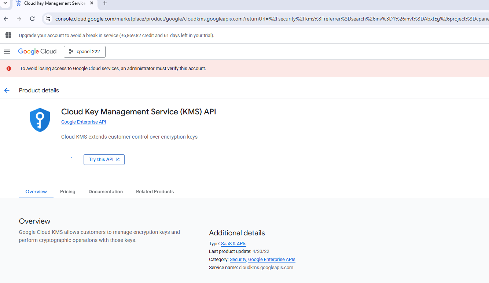

---

## 2. Key concepts

Cloud KMS lets you create and manage encryption keys for Google Cloud services and your own applications. You can generate software or hardware keys, import existing keys, or link keys held in an external key manager (EKM). You can also use KMS keys to create and verify digital signatures or message authentication codes (MACs).

### Default encryption vs customer-managed keys

| Option | Who manages the key | Notes |
|---|---|---|
| Google default encryption | Google | Automatic, no configuration, FIPS 140-2 Level 1 validated modules |
| CMEK, software keys | You, in Cloud KMS | Symmetric keys support automatic rotation. Asymmetric keys rotate manually |
| CMEK, imported keys | You | You import key material and rotate by importing new versions |
| CMEK, Cloud HSM | You, in Cloud KMS | Keys live in FIPS 140-2 Level 3 HSMs |
| CMEK, Cloud EKM | You, outside Google | Keys stay in an external key manager |

### Key purposes

The purpose is chosen at key creation and cannot change. All versions of a key share the same purpose.

| Scenario | Purpose in the console | API purpose | Methods |
|---|---|---|---|
| Symmetric encryption | Symmetric encrypt/decrypt | `ENCRYPT_DECRYPT` | `encrypt`, `decrypt` |
| Raw symmetric encryption | Raw symmetric encrypt/decrypt | `RAW_ENCRYPT_DECRYPT` | `rawEncrypt`, `rawDecrypt` |
| Asymmetric signing | Asymmetric sign | `ASYMMETRIC_SIGN` | `asymmetricSign`, `getPublicKey` |
| Asymmetric encryption | Asymmetric decrypt | `ASYMMETRIC_DECRYPT` | `asymmetricDecrypt`, `getPublicKey` |
| MAC signing | MAC signing/verification | `MAC` | `macSign`, `macVerify` |

### Symmetric encryption in brief

The same secret key encrypts and decrypts, so both sides must hold it. In KMS the key never leaves the service. You send data in, you get ciphertext back.

### Cloud KMS resources

| Resource | What it is |
|---|---|
| Key ring | Groups keys in one location and lets you manage access to the group |
| Key | Named object holding one or more key versions plus metadata |
| Type / purpose | Symmetric or asymmetric. Purpose is chosen at creation |
| Primary version | A symmetric key has at most one primary version, used when you do not name a version. **Asymmetric keys have no primary version, so you must name the version on every call** |
| State | Enabled, Disabled, Scheduled for destruction or Destroyed |
| Algorithm | Decides how key material is created and which operations are possible |

---

## 3. Part 1: Symmetric encryption

### 3.1 Create the key ring and key

**Step 1. Create the key ring.** Go to *Security → Key Management → Key rings → Create key ring*. Name it `test-ring` and choose the location `us-central1`.

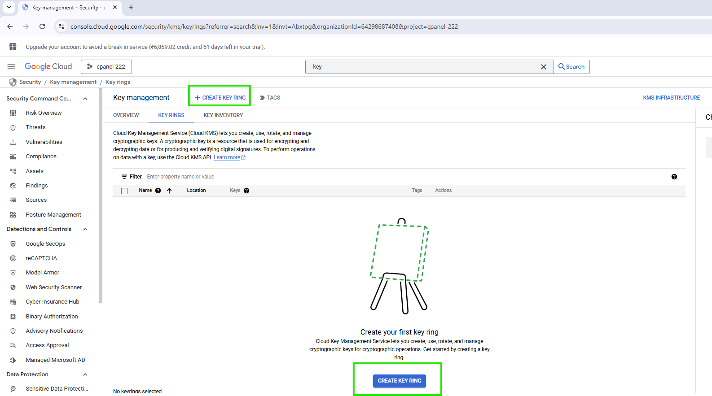

> A key ring is tied to its location and cannot be deleted later, so choose names and locations deliberately.

**Step 2. Create the key.** Inside the key ring choose *Create key* and set:

| Setting | Value |
|---|---|
| Key name | `symmetric-key` |
| Protection level | Software |

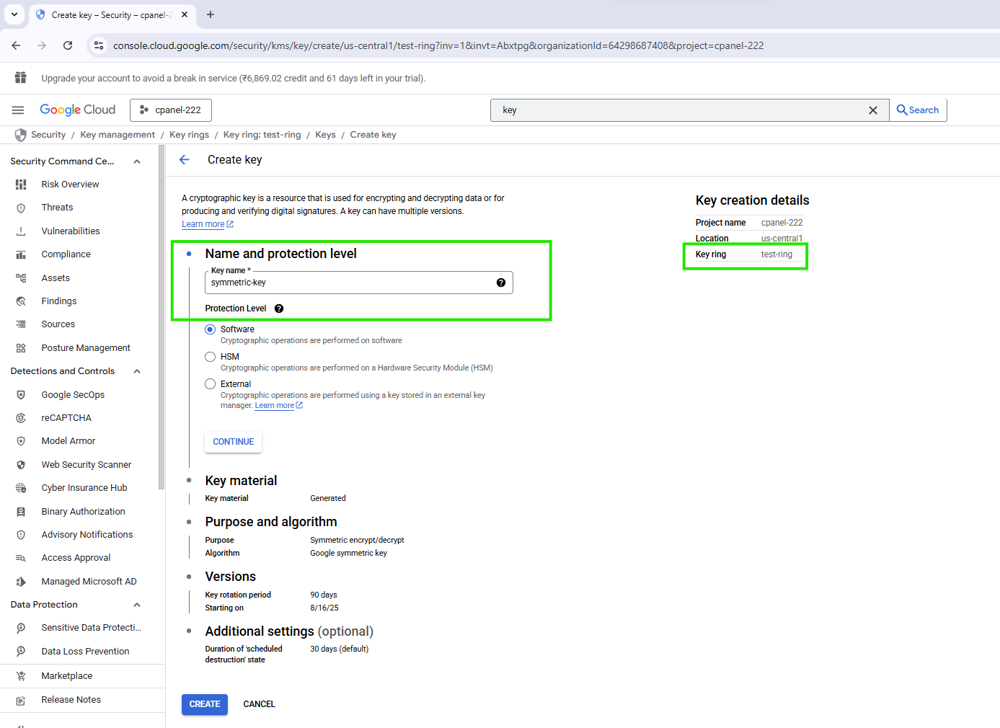

Protection level choices are *Software*, *HSM* and *External*. Choosing *External* asks for the EKM connection type (via internet or via VPC), which needs an external key manager that you do not have in this demo.

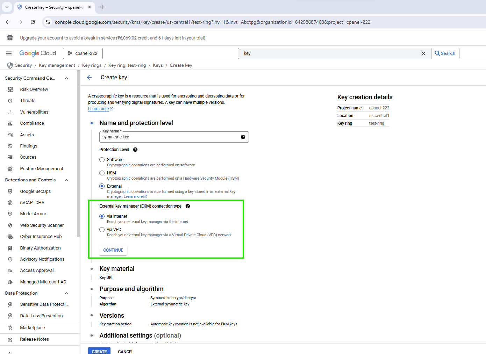

**Step 3. Key material.** Choose *Generated key*. The alternative, *Imported key*, is for bringing your own key material.

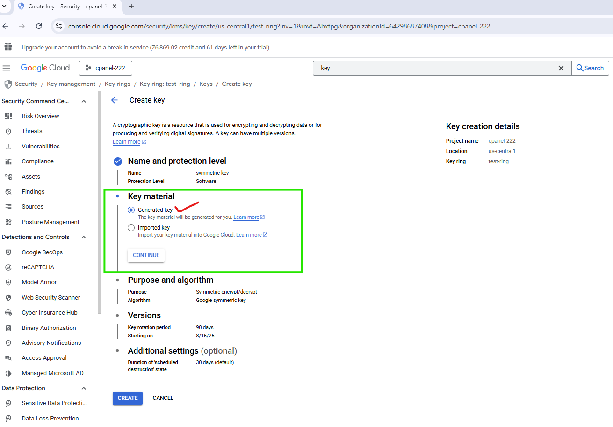

**Step 4. Purpose and algorithm.** The dropdown offers symmetric encrypt/decrypt, raw symmetric encrypt/decrypt, asymmetric sign, asymmetric decrypt and MAC signing/verification. Choose **Symmetric encrypt/decrypt**, which gives the algorithm *Google symmetric key*.

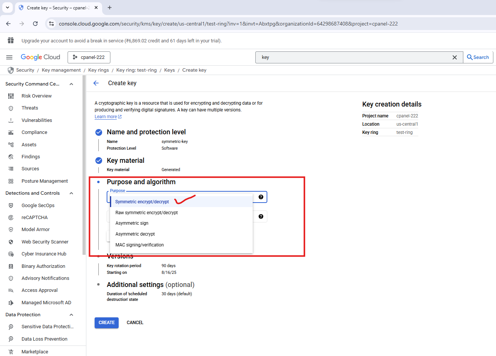
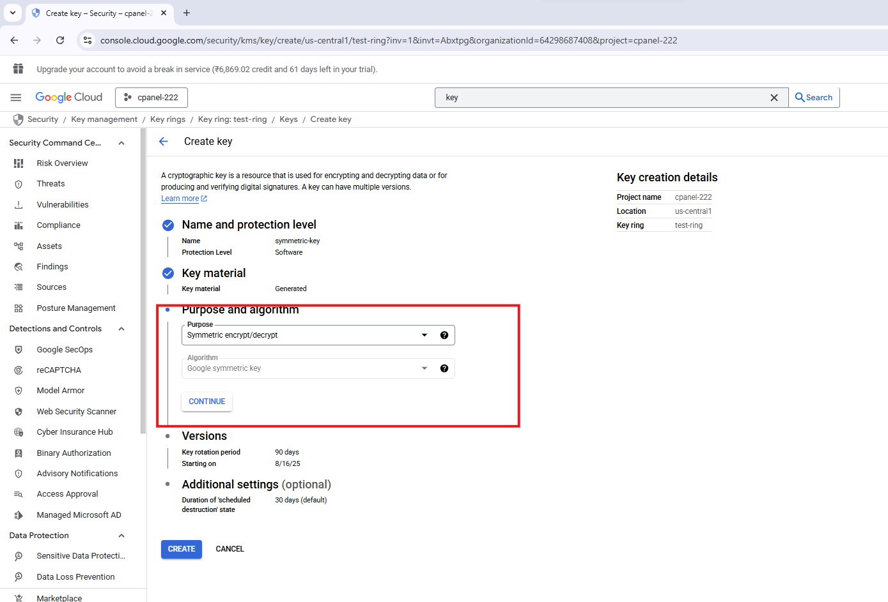

**Step 5. Rotation.** Options are 30, 90, 180 or 365 days, *Never (manual rotation)* or a custom period. This demo uses **90 days**.

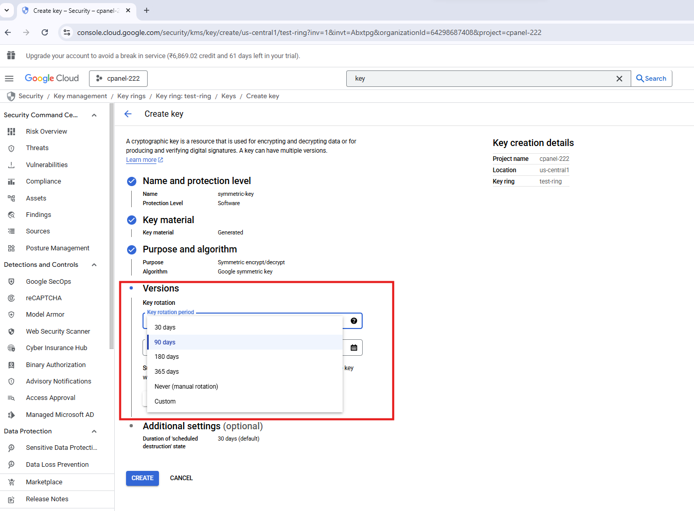
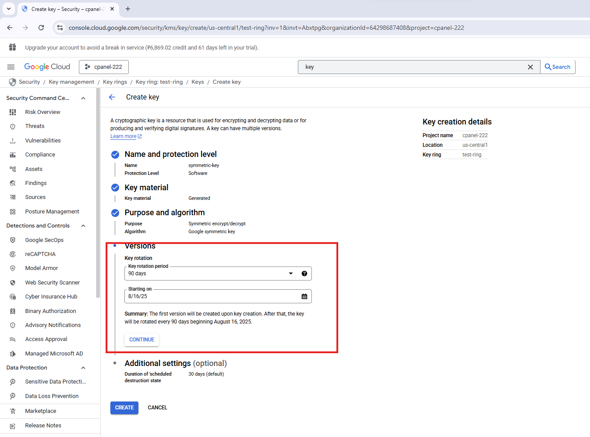

**Step 6. Scheduled destruction duration.** When a key version is destroyed it first sits in *scheduled for destruction* and can still be restored. The default is 30 days. This demo sets **10 days**. Click *Create*.

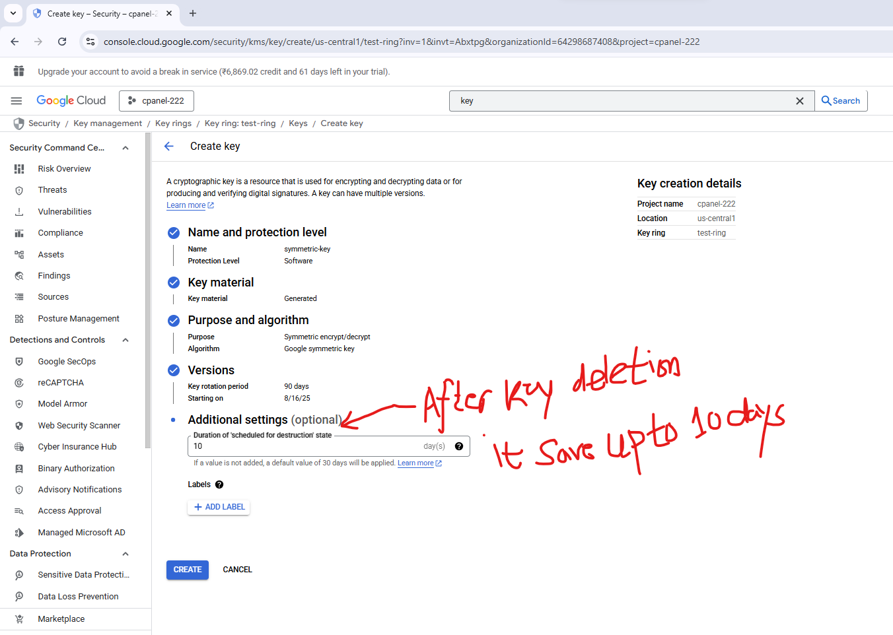

**Result.** `symmetric-key` shows as *Available*, with protection level *Software* and purpose *Symmetric encrypt/decrypt*.

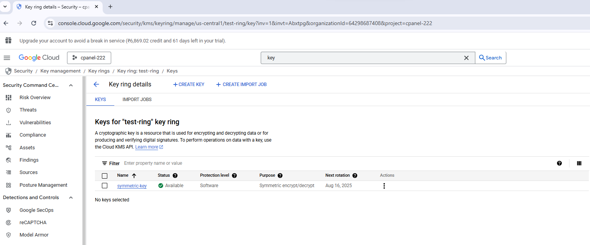

### 3.2 Encrypt and decrypt

Create a test file and encrypt it in Cloud Shell.

```bash
mkdir -p ~/KMS-demo && cd ~/KMS-demo
echo "Welcome to Cloud KMS Demo" > test.txt
```

**Encrypt**

```bash
gcloud kms encrypt \
  --key symmetric-key \
  --keyring test-ring \
  --location us-central1 \
  --plaintext-file test.txt \
  --ciphertext-file encrypt.txt
```

`cat encrypt.txt` now shows unreadable binary output. That is the ciphertext.

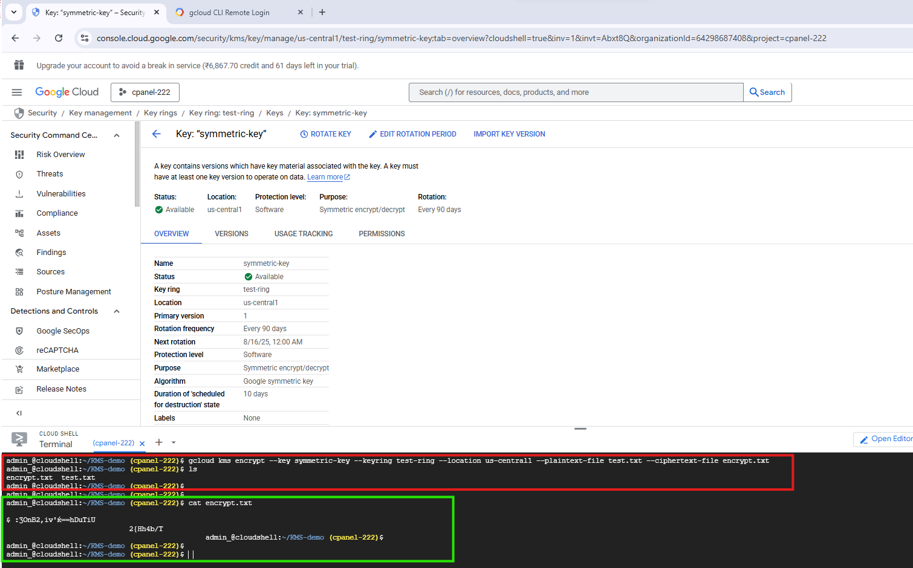

**Decrypt**

```bash
gcloud kms decrypt \
  --key symmetric-key \
  --keyring test-ring \
  --location us-central1 \
  --ciphertext-file encrypt.txt \
  --plaintext-file decrypt.txt

cat decrypt.txt     # Welcome to Cloud KMS Demo
```

You do not pass a key version. KMS reads the version from the ciphertext metadata.

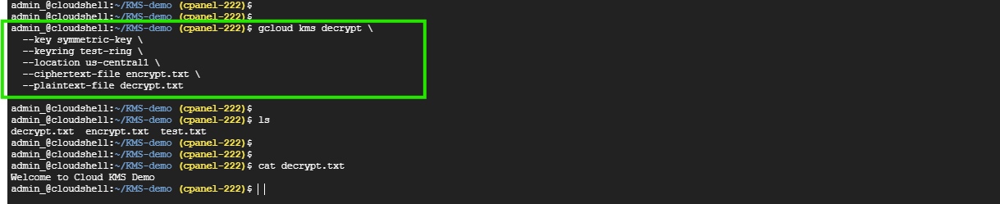

### 3.3 Rotate the key

Rotation creates a new key version so that new data is encrypted with fresh key material. It is the answer to "how do I make everything created from now on use a new key version?"

**Step 1.** Open the key, then the **Versions** tab. Version 1 is *Enabled & primary*. Click **Rotate key**.

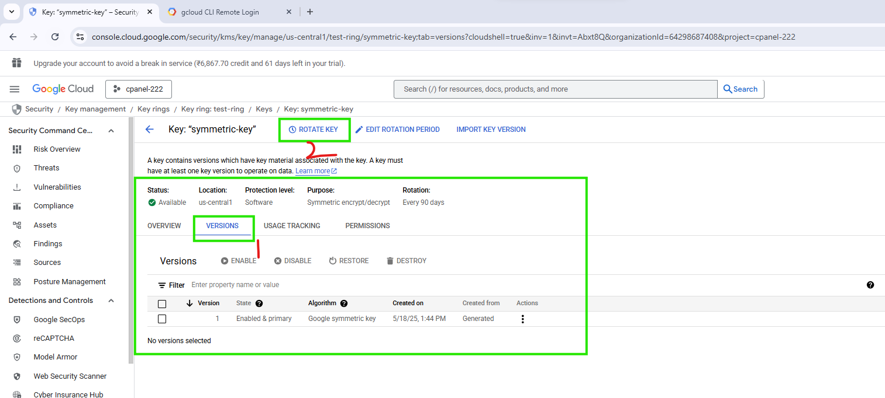

**Step 2.** Read the dialog. A new version is created and made primary, and new data is encrypted with it. Older versions can still decrypt data, and data encrypted with older versions is **not** re-encrypted unless you do it yourself. Click *Rotate*.

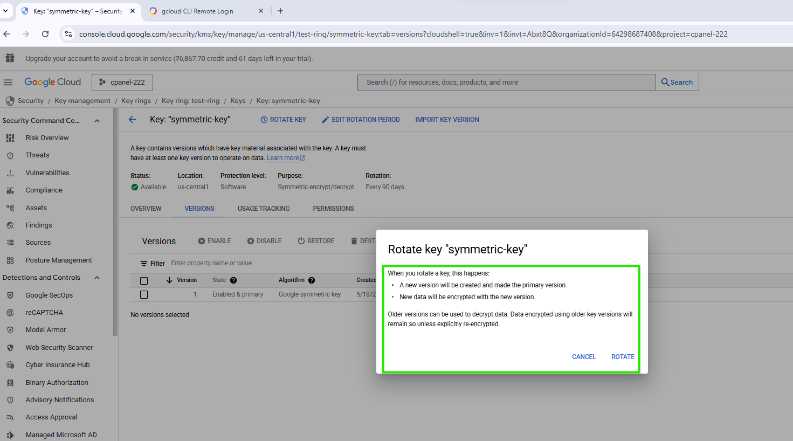

**Step 3.** Version 2 is now *Enabled & primary* and version 1 is *Enabled*.

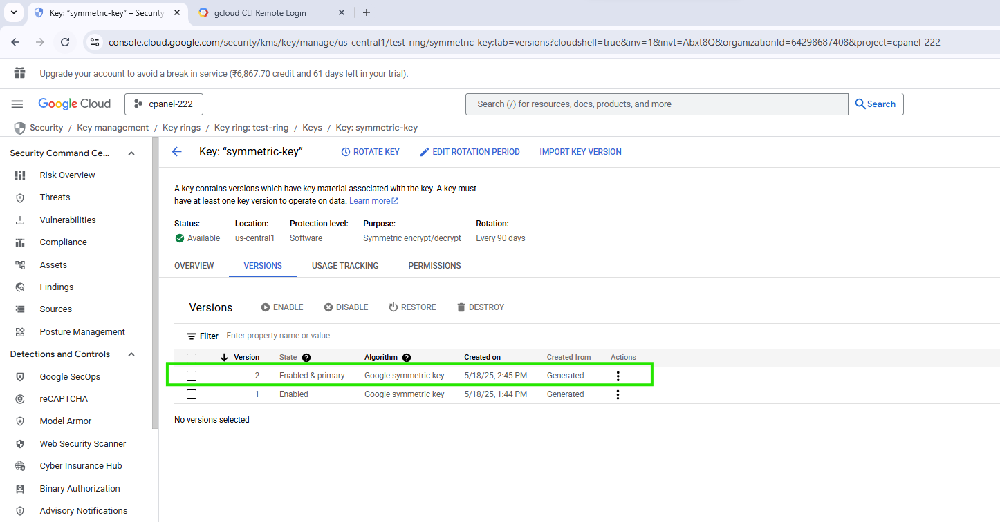

**Step 4. Decrypt old data after rotation.** `encrypt.txt` was created with version 1. Decrypt it again with the same command and a different output file.

```bash
gcloud kms decrypt \
  --key symmetric-key \
  --keyring test-ring \
  --location us-central1 \
  --ciphertext-file encrypt.txt \
  --plaintext-file decrypt-2.txt

cat decrypt-2.txt   # Welcome to Cloud KMS Demo
```

The old ciphertext decrypts fine, because KMS picks the version that produced it.

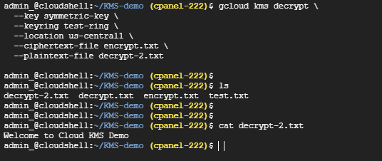

**Step 5. Change the primary version (optional).** On the versions list, open the actions menu for version 1 and choose **Make primary version**. Primary status only controls which version *new* encryptions use.

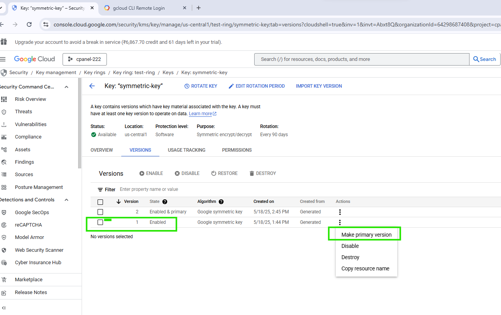

### 3.4 Use the key for Cloud Storage (CMEK)

Customer-managed encryption keys (CMEK) let Cloud Storage encrypt bucket objects with your KMS key.

**Step 1. Create a bucket.** In *Cloud Storage → Create bucket* choose a name (this demo uses `cloud-kms-demo-bucket`) and a region. Under **Data encryption**, select **Cloud KMS key**.

**Location rule.** The key and the bucket must be in the same location. The key lives in `us-central1`, so a bucket in `us-east1` shows *"No valid keys found"* in the key picker: the filter reads *Key purpose: Symmetric Encrypt/Decrypt* and *Locations: us-east1*.

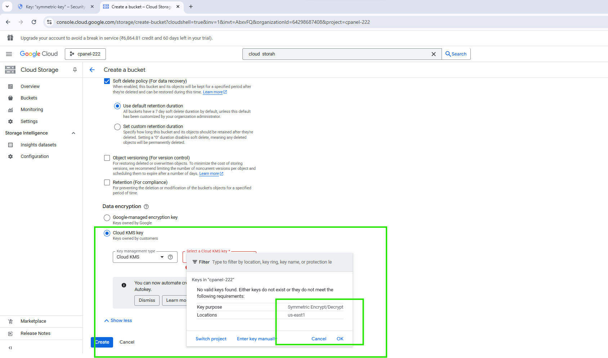

**Step 2. Choose `us-central1` and select `symmetric-key`.** The console warns that the Cloud Storage service agent does not have the `cloudkms.cryptoKeyEncrypterDecrypter` role on the key. Click **Grant**. A missing service-agent binding is the most common cause of CMEK failures.

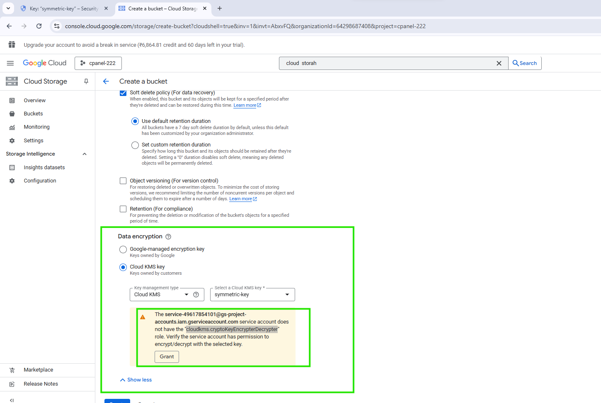

**Step 3. Create the bucket and verify.** Under *Configuration → Protection*, **Encryption type** is *Customer-managed* and **Default encryption key** points to `…/test-ring/symmetric-key`.

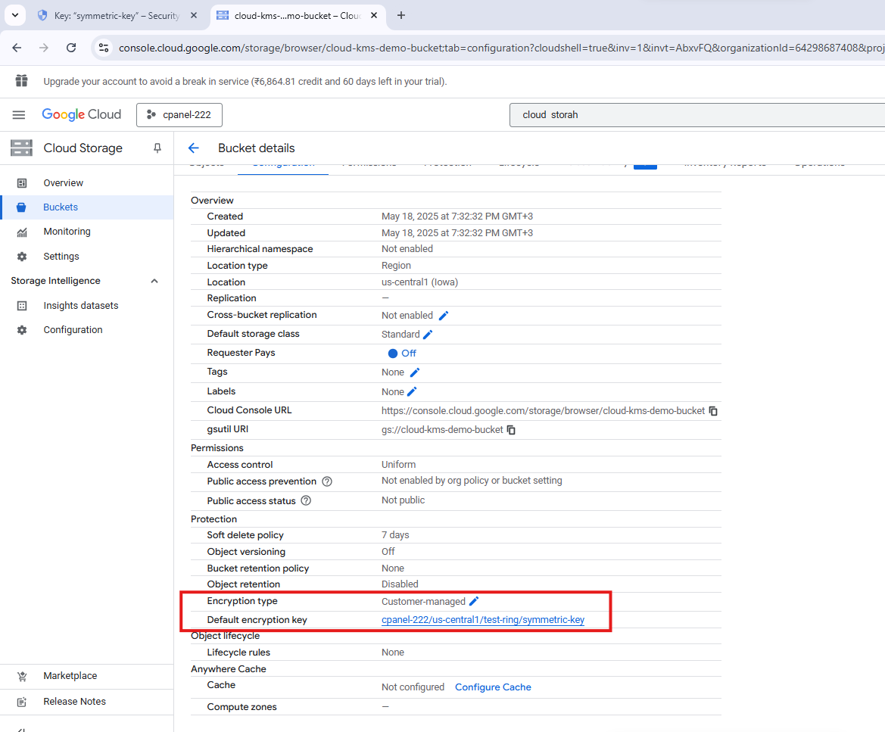

**Step 4. Upload objects.** Upload two files (`image016.png` and `s3.jpeg` in the demo). The **Encryption** column shows *Customer-managed* for each.

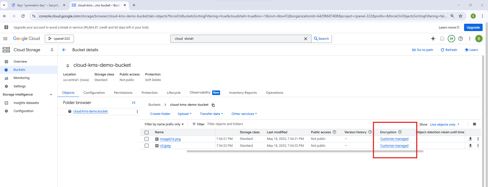

**Step 5. Inspect an object.** Open `s3.jpeg`. *Encryption type* is *Customer-managed* and *Encryption key* shows the exact key version, here `…/cryptoKeyVersions/2`, the primary version at upload time.

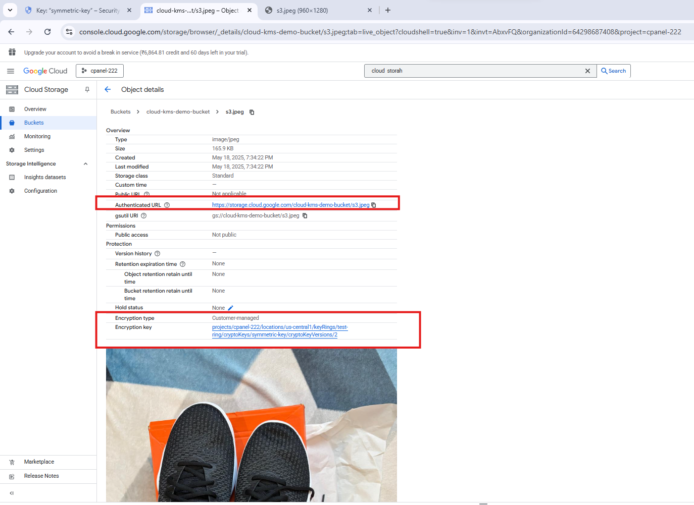

Listing from Cloud Shell works as normal because encryption is transparent to authorised users:

```bash
gsutil ls gs://cloud-kms-demo-bucket/
```

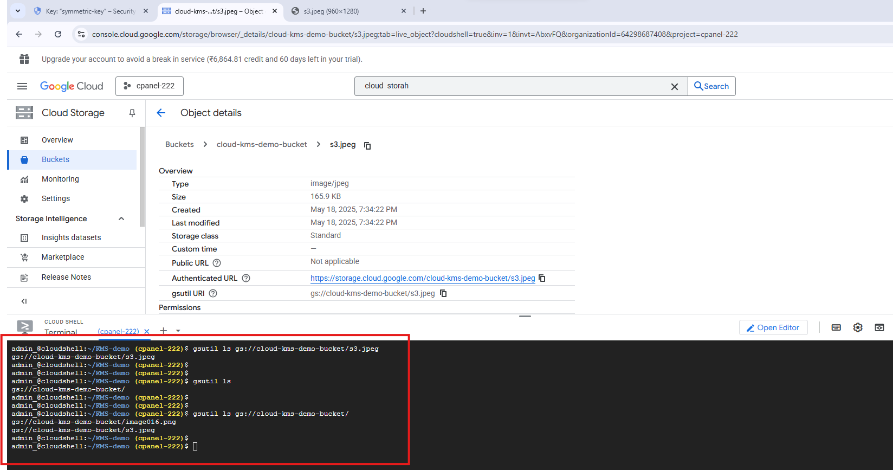

### 3.5 What happens when the key is disabled

This is the demo that shows why CMEK gives you a kill switch.

**Step 1. Disable the key versions.** Disable both versions from the Versions tab. The key status turns to *Not available* with the message *"To operate on data with this key, enable primary version or select a new primary version."*

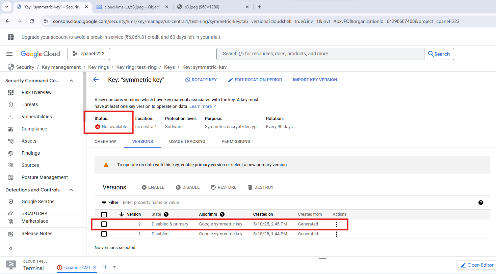

**Step 2. Try to encrypt.** The CLI fails with `FAILED_PRECONDITION`, stating that the key version is not enabled and its current state is `DISABLED`.

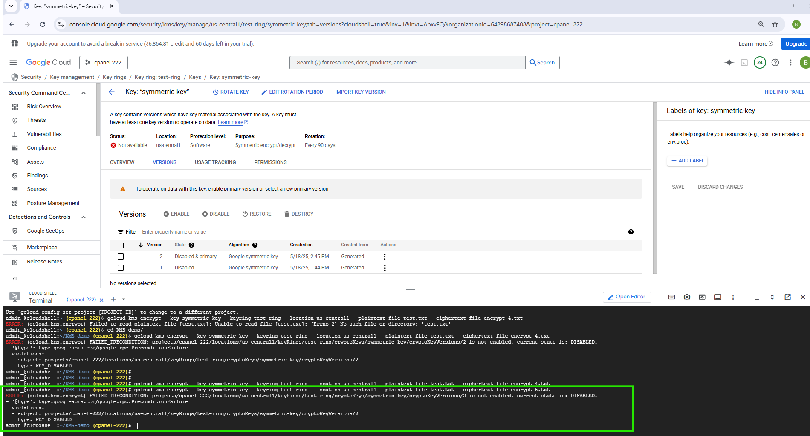

**Step 3. Try to open the object.** Downloading `s3.jpeg` returns the message **"Cloud KMS key is disabled, destroyed, or scheduled to be destroyed."**

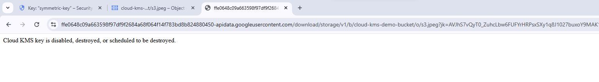

Re-enable the versions to restore access. Disable is reversible. Destroy is not, once the scheduled destruction delay (10 days here) has passed.

---

## 4. Part 2: Asymmetric encryption

Asymmetric (public-key) cryptography uses a key pair. The **public key** is shared freely and encrypts. The **private key** never leaves KMS and decrypts.

### 4.1 Create the asymmetric key

In `test-ring`, choose *Create key*.

| Setting | Value |
|---|---|
| Key name | `asymmetric-key-decrypt` |
| Protection level | Software |
| Key material | Generated |
| Purpose | **Asymmetric decrypt** |
| Algorithm | **3072 bit RSA - OAEP Padding - SHA256 Digest** (128 bits of security) |
| Rotation | Not available. Asymmetric keys rotate manually |
| Scheduled destruction | 10 days |

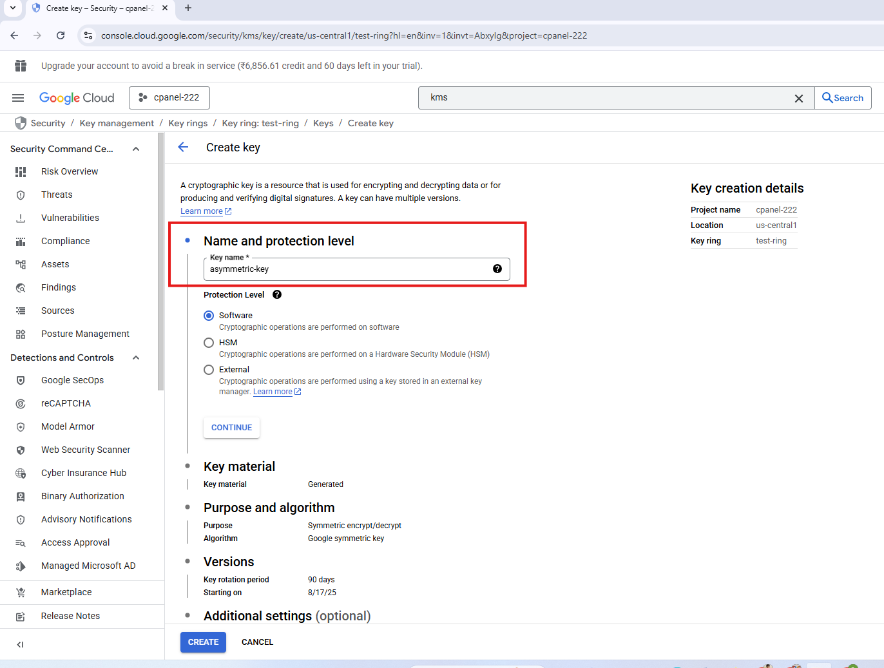
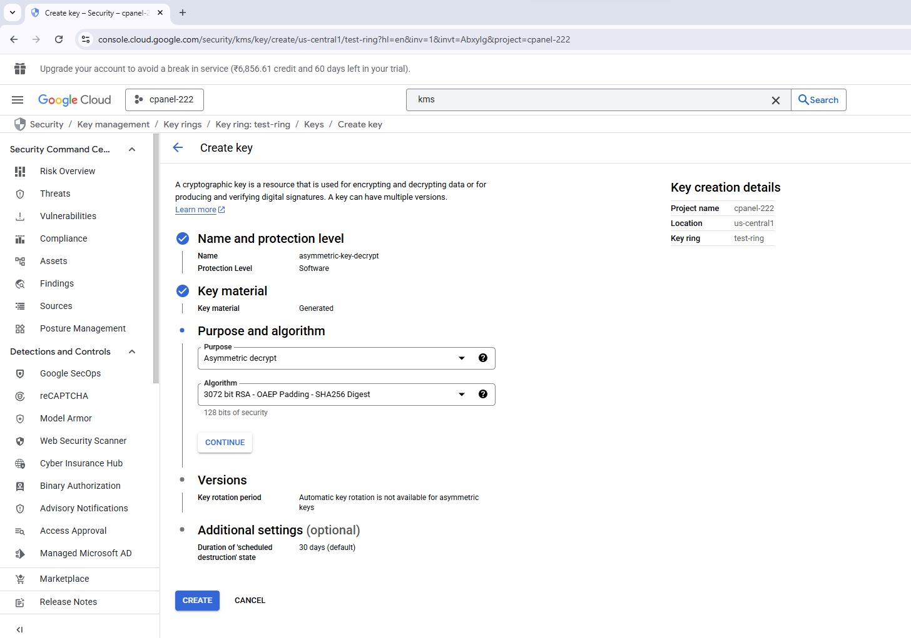
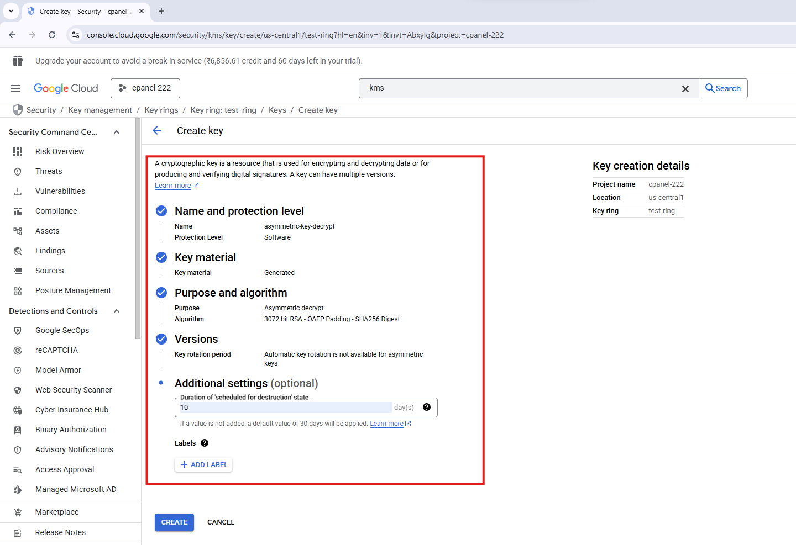

After creation, the Overview tab confirms location `us-central1`, purpose *Asymmetric decrypt*, and the algorithm.

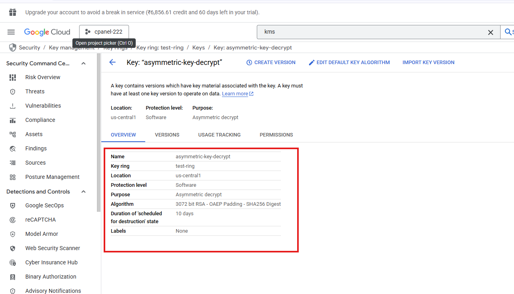

### 4.2 Download the public key

To encrypt with an asymmetric key you need the public key first. On the **Versions** tab, open the actions menu for version 1 and choose **Get public key**, then **Download**.

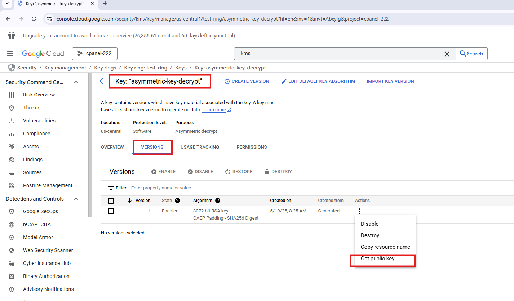
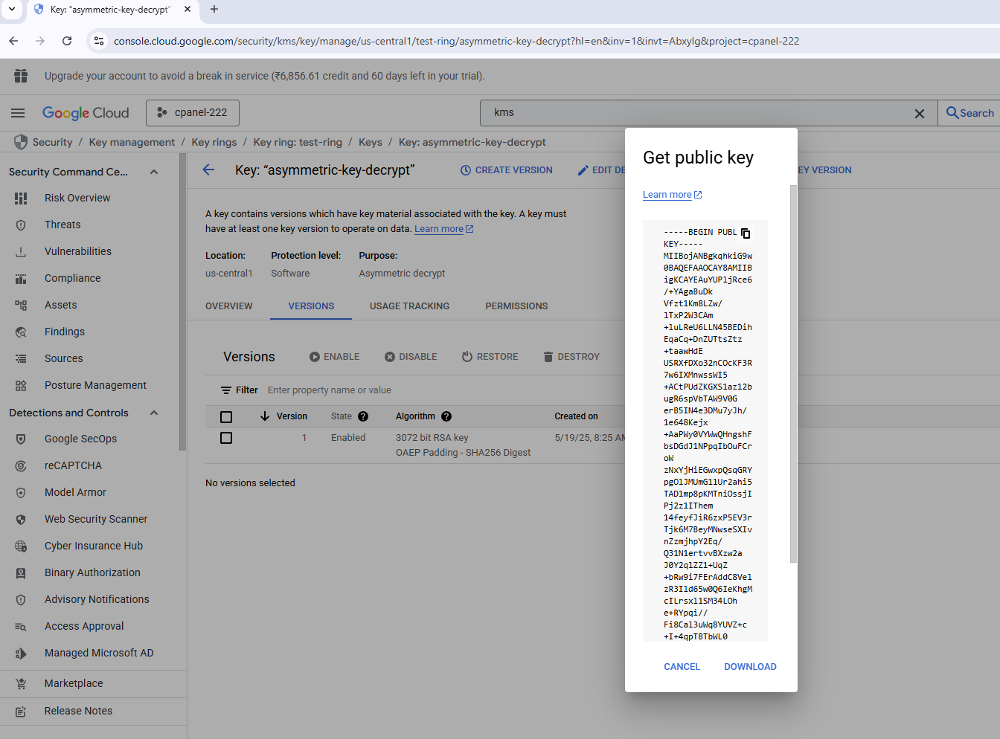

CLI alternative:

```bash
gcloud kms keys versions get-public-key 1 \
  --key asymmetric-key-decrypt \
  --keyring test-ring \
  --location us-central1 \
  --output-file test-ring-asymmetric-key-decrypt-1.pub
```

Upload the `.pub` file to Cloud Shell (or use the command above) and create a test file:

```bash
echo "Welcome to Cloud KMS Asymmetric key demo" > test.txt
```

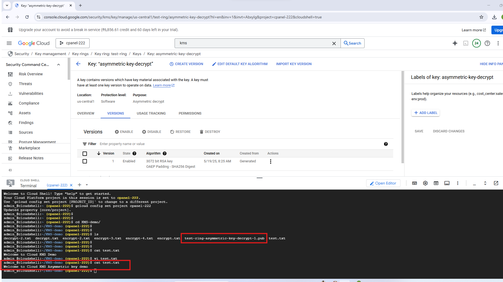

### 4.3 Encrypt locally with OpenSSL

Encryption happens on your machine using only the public key. KMS is not involved. The padding and digest must match the key's algorithm (OAEP, SHA-256).

```bash
openssl pkeyutl -in test.txt \
  -encrypt \
  -pubin \
  -inkey test-ring-asymmetric-key-decrypt-1.pub \
  -pkeyopt rsa_padding_mode:oaep \
  -pkeyopt rsa_oaep_md:sha256 \
  -pkeyopt rsa_mgf1_md:sha256 \
  > encrypt.txt
```

`encrypt.txt` is now unreadable ciphertext.

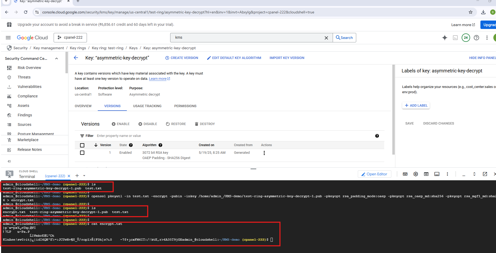

### 4.4 Decrypt with KMS

Decryption needs the private key, so it runs inside KMS. Because asymmetric keys have no primary version, **you must specify `--version`**.

```bash
gcloud kms asymmetric-decrypt \
  --version 1 \
  --key asymmetric-key-decrypt \
  --keyring test-ring \
  --location us-central1 \
  --ciphertext-file encrypt.txt \
  --plaintext-file decrypt.txt

cat decrypt.txt
```

### 4.5 Prove that the version matters

Create a second version. On the key page choose **Create version** and confirm.

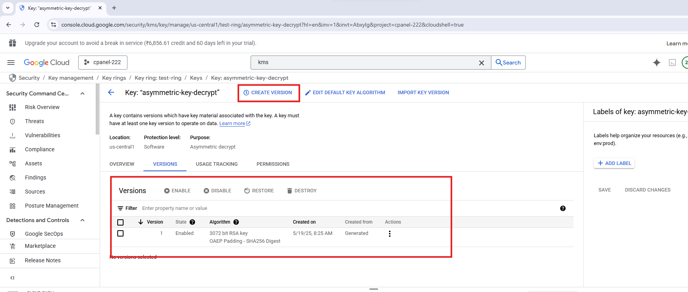
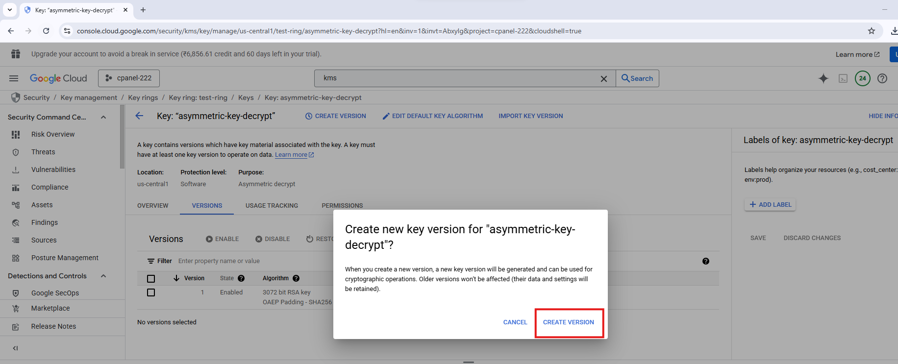

The key now has versions 1 and 2, both enabled. Note there is no *primary* label.

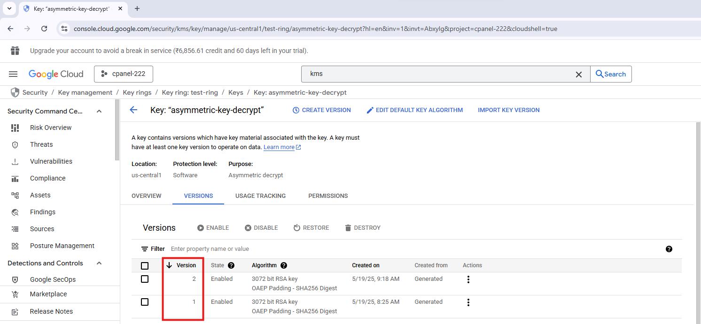

`encrypt.txt` was encrypted with the **version 1 public key**. Decrypt it with version 2:

```bash
gcloud kms asymmetric-decrypt \
  --version 2 \
  --key asymmetric-key-decrypt \
  --keyring test-ring \
  --location us-central1 \
  --ciphertext-file encrypt.txt \
  --plaintext-file decrypt.txt
```

Result: `ERROR: (gcloud.kms.asymmetric-decrypt) INVALID_ARGUMENT: Decryption failed.`

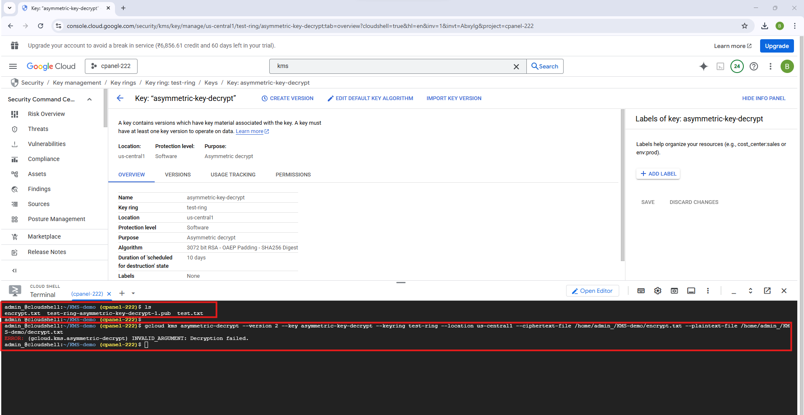

Switch to `--version 1` and it works, printing `Welcome to Cloud KMS Asymmetric key demo`.

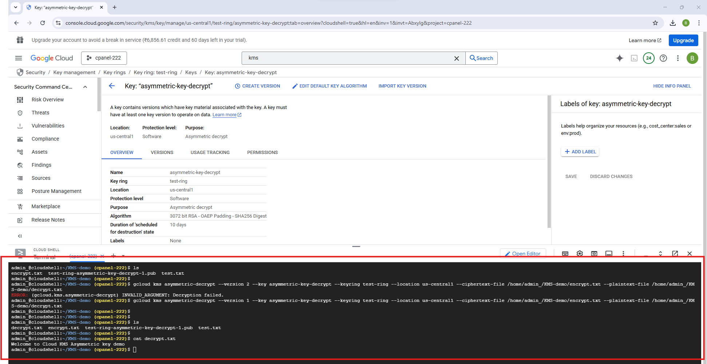

**Takeaway.** The ciphertext is bound to the key pair that created the public key. Keep track of which version encrypted what.

Reference for the OpenSSL flags: [Encrypt and decrypt data with an asymmetric key](https://cloud.google.com/kms/docs/encrypt-decrypt-rsa).

---

## 5. Part 3: Digital signatures

A digital signature proves **who** signed data and that it was **not changed**. The signer uses the private key. Anyone with the public key can verify.

1. The signer creates an asymmetric signing key.
2. The signer performs a private-key operation over the data (a hash of it) to create the signature.
3. The signer sends the data and the signature to the recipient.
4. The recipient verifies with the public key. If verification fails, the data was altered.

### 5.1 Create the signing key

| Setting | Value |
|---|---|
| Key name | `asymmetric-sign` |
| Protection level | Software |
| Purpose | **Asymmetric sign** |
| Algorithm | **Elliptic Curve P-256 - SHA256 Digest** (128 bits of security) |

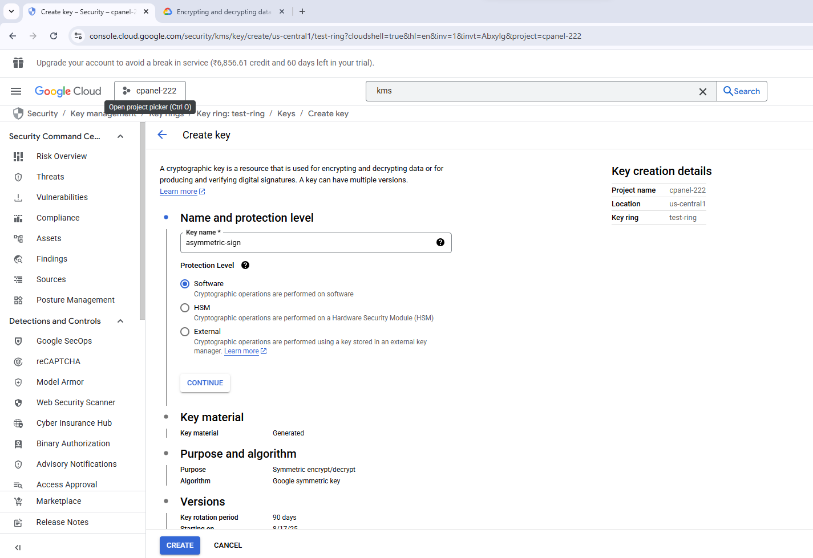
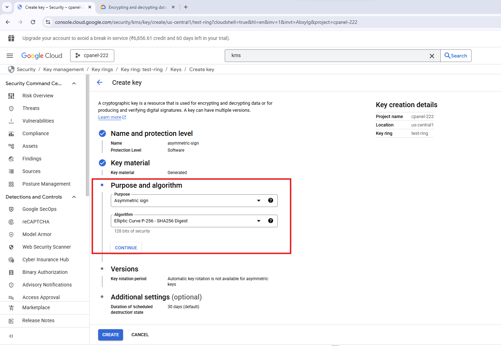

Then download the public key from *Versions → actions → Get public key*.

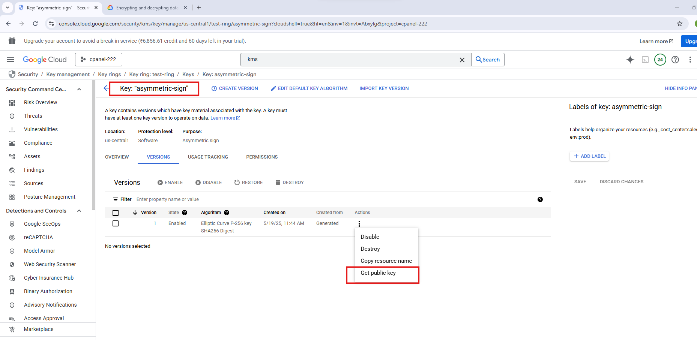

```bash
gcloud kms keys versions get-public-key 1 \
  --key asymmetric-sign \
  --keyring test-ring \
  --location us-central1 \
  --output-file test-ring-asymmetric-sign-1.pub
```

### 5.2 Sign and verify

**Sign** the file. KMS hashes with SHA-256 and signs with the private key.

```bash
echo "This is Asymmetric-sign demo" > test.txt

gcloud kms asymmetric-sign \
  --version 1 \
  --key asymmetric-sign \
  --keyring test-ring \
  --location us-central1 \
  --digest-algorithm sha256 \
  --input-file test.txt \
  --signature-file sign.txt
```

**Verify** with OpenSSL, using only the public key:

```bash
openssl dgst \
  -sha256 \
  -verify test-ring-asymmetric-sign-1.pub \
  -signature sign.txt \
  test.txt
```

Output: `Verified OK`

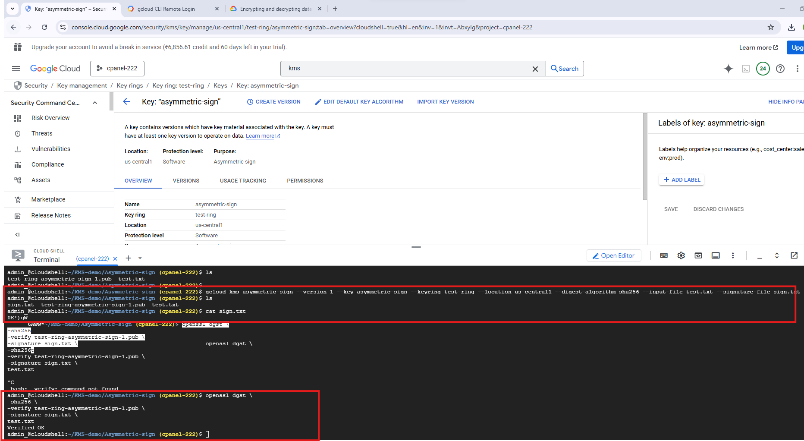

### 5.3 Tamper with the file

Edit `test.txt` (the demo appends the line `Tempared file`) and run the same verify command:

```
Verification failure
```

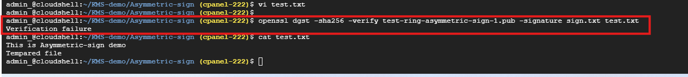

**Real-world use.** When you share a file over the internet, send the file together with `sign.txt`. The recipient verifies it with your public key (`.pub`) and knows the file is yours and unmodified. The same pattern secures code, container images (Binary Authorization) and JWTs.

---

## 6. Part 4: MAC signatures

A MAC (message authentication code) also verifies integrity and authenticity, but it is **symmetric**. The same secret key creates and verifies the tag, so both sides must hold the key. That is why **there is no public key to download** for a MAC key.

1. Signer and recipient agree on one MAC key.
2. The signer computes a MAC tag over the data.
3. The signer sends the data and the tag.
4. The recipient verifies the tag with the same key. If it fails, the data was altered.

### 6.1 Create the MAC key

| Setting | Value |
|---|---|
| Key name | `mac-key` |
| Protection level | Software |
| Purpose | **MAC signing/verification** |
| Algorithm | **HMAC - SHA256 Digest** |
| Rotation | Not available for MAC keys |
| Scheduled destruction | 10 days |

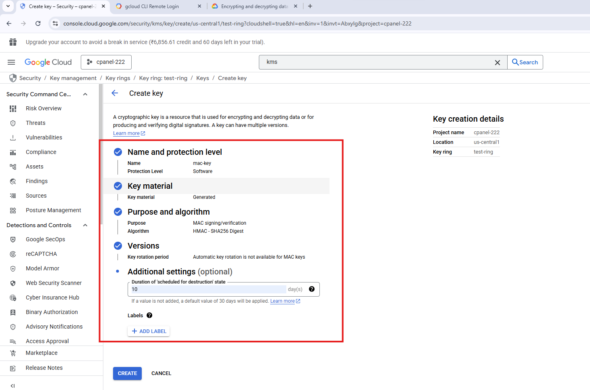

The version's action menu offers only *Disable*, *Destroy* and *Copy resource name*. There is no *Get public key*.

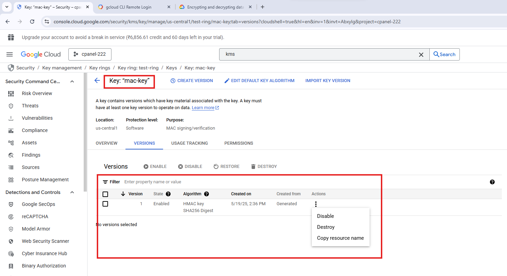

### 6.2 Sign

```bash
mkdir -p MAC-sign && cd MAC-sign
echo "This is the MAC signing demo" > mac-sign

gcloud kms mac-sign \
  --version 1 \
  --key mac-key \
  --keyring test-ring \
  --location us-central1 \
  --input-file mac-sign \
  --signature-file mac.txt
```

`mac.txt` holds the binary MAC tag.

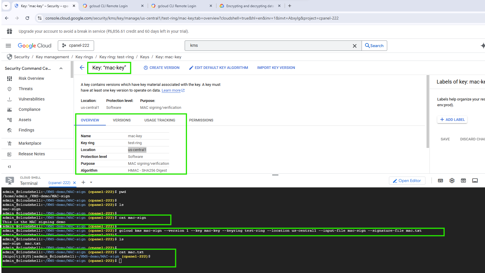

### 6.3 Verify

```bash
gcloud kms mac-verify \
  --version 1 \
  --key mac-key \
  --keyring test-ring \
  --location us-central1 \
  --input-file mac-sign \
  --signature-file mac.txt
```

Output: `True`

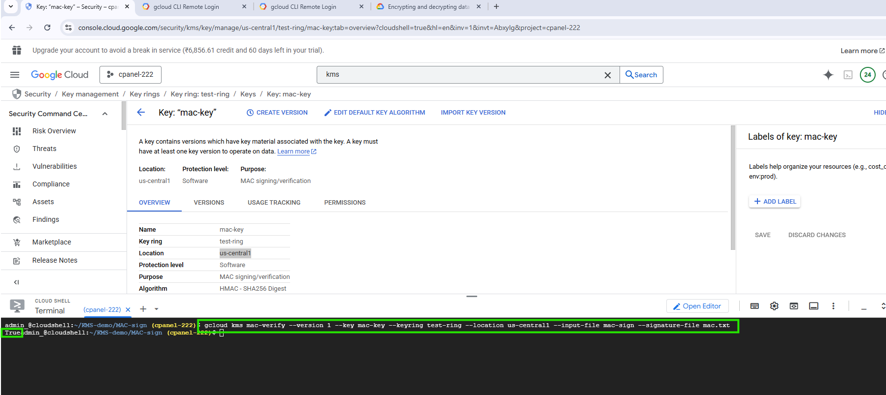

### 6.4 Alter the file and verify again

Edit `mac-sign` (the demo adds the line `Altered File`) and repeat the verify command. The result is **no `True`**; the demo shows `None`, so the check fails.

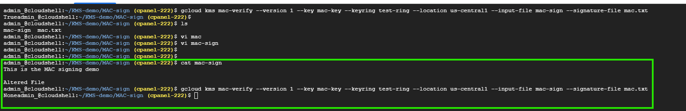

### 6.5 Two ways to prove a file was not altered

Say you share `file1` with a user who wants to know whether it was changed. There are two options:

1. **MAC verification.** Give the user the MAC tag and let them verify it with the shared MAC key. This works even if they do not have the original.
2. **Regenerate and `diff`.** Re-create the file from the same source and compare with `diff file1 file1-regenerated`. This only works when you can reproduce the file.

---

## 7. Which key purpose should I use?

| Need | Purpose | Key type | Who holds what |
|---|---|---|---|
| Encrypt your own data, CMEK for GCP services | Symmetric encrypt/decrypt | Symmetric | Key stays in KMS. Callers need IAM on the key |
| Let outsiders send you encrypted data | Asymmetric decrypt | Asymmetric | Anyone holds the public key. Private key stays in KMS |
| Prove who published something and that it is unchanged | Asymmetric sign | Asymmetric | Private key signs in KMS. Anyone verifies with the public key |
| Integrity check between two trusted parties | MAC | Symmetric | Both sides call KMS with the same key. No public key exists |

## 8. Security and operations checklist

- **Separate duties.** `cloudkms.admin` manages keys and cannot use them. `cloudkms.cryptoKeyEncrypterDecrypter` uses keys and cannot manage them.
- **Use a dedicated KMS project** for key rings, apart from workloads.
- **Match locations.** The key and the resource must be in the same location.
- **Grant the service agent** the encrypter/decrypter role before creating CMEK resources.
- **Turn on Data Access audit logs** for Cloud KMS to see every encrypt and decrypt call. Admin Activity logs are always on.
- **Alert on key disable and destroy** events. Disabling a key makes the data unreadable immediately.
- **Keep the scheduled destruction delay long enough** to recover from mistakes.
- **Rotation does not re-encrypt old data.** It only changes the version used for new operations.
- **Track key versions for asymmetric keys.** The caller must name the version.
- **Never commit `.pub`, ciphertext or signature files** that you do not want public, and never put plaintext secrets in `test.txt`-style demo files.

## 9. Cleanup

Key rings and keys cannot be deleted. You can only destroy key **versions**, which then wait out the scheduled destruction delay.

1. Delete the demo bucket and its objects:
   ```bash
   gsutil rm -r gs://cloud-kms-demo-bucket
   ```
2. Destroy key versions you no longer need (*Versions → select → Destroy*, or `gcloud kms keys versions destroy`).
3. Remove local files: `rm -rf ~/KMS-demo`.

Active key versions are billed, so destroy the demo versions when you are done. See the [Cloud KMS pricing page](https://cloud.google.com/kms/pricing).

## 10. Appendix: CLI equivalents of the console steps

The demo created keys in the console. These are the equivalent commands. They were **not** part of the recorded demo, so check `gcloud kms keys create --help` on your gcloud version.

```bash
export LOCATION=us-central1 KEYRING=test-ring

# Enable the API and create the key ring
gcloud services enable cloudkms.googleapis.com
gcloud kms keyrings create $KEYRING --location $LOCATION

# Symmetric key, 90-day rotation, 10-day destruction delay
gcloud kms keys create symmetric-key \
  --keyring $KEYRING --location $LOCATION \
  --purpose encryption \
  --rotation-period 90d --next-rotation-time "$(date -u -d '+90 days' +%Y-%m-%dT%H:%M:%SZ)" \
  --destroy-scheduled-duration 10d

# Asymmetric decrypt key (RSA 3072, OAEP, SHA-256)
gcloud kms keys create asymmetric-key-decrypt \
  --keyring $KEYRING --location $LOCATION \
  --purpose asymmetric-encryption \
  --default-algorithm rsa-decrypt-oaep-3072-sha256 \
  --destroy-scheduled-duration 10d

# Asymmetric signing key (EC P-256, SHA-256)
gcloud kms keys create asymmetric-sign \
  --keyring $KEYRING --location $LOCATION \
  --purpose asymmetric-signing \
  --default-algorithm ec-sign-p256-sha256 \
  --destroy-scheduled-duration 10d

# MAC key (HMAC SHA-256)
gcloud kms keys create mac-key \
  --keyring $KEYRING --location $LOCATION \
  --purpose mac \
  --default-algorithm hmac-sha256 \
  --destroy-scheduled-duration 10d

# Rotate manually (new primary version) and change the primary version
gcloud kms keys versions create --key symmetric-key --keyring $KEYRING --location $LOCATION --primary
gcloud kms keys set-primary-version symmetric-key --version 1 --keyring $KEYRING --location $LOCATION

# Disable and re-enable a version
gcloud kms keys versions disable 2 --key symmetric-key --keyring $KEYRING --location $LOCATION
gcloud kms keys versions enable  2 --key symmetric-key --keyring $KEYRING --location $LOCATION
```

## 11. References

- [Cloud KMS documentation](https://cloud.google.com/kms/docs)
- [Encrypt and decrypt data with an asymmetric key](https://cloud.google.com/kms/docs/encrypt-decrypt-rsa)
- [Customer-managed encryption keys (CMEK)](https://cloud.google.com/kms/docs/cmek)
